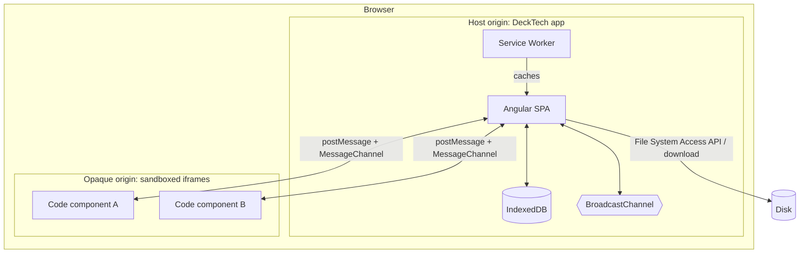

# 3. Context and Scope

## 3.1 Business context

```mermaid
flowchart LR
    Author([Author / Presenter])
    Agent([AI agent<br/>via MCP client])
    Audience([Audience])
    Recipient([Deck recipient])
    DT[DeckTech]
    FS[(Local file system<br/>.deck, PDF, PNG)]
    Web[(Web resources<br/>images, fonts, APIs<br/>used by slides)]

    Author -- creates, edits, presents --> DT
    Agent -. builds .deck files .-> FS
    DT -- projected / screen-shared slides --> Audience
    DT <-- import / export --> FS
    FS -- shared .deck file --> Recipient
    Recipient -- opens --> DT
    DT -. optional, author-controlled .-> Web
```

| Partner | Input / Output |
|---------|----------------|
| Author | Edits slides and code; receives live preview. |
| AI agent | Builds a deck through the MCP server (`mcp/`, ADR-013) and hands it over as a `.deck` file; never talks to the running app. The code it writes is untrusted until the author accepts it at import (ADR-008). |
| Audience | Sees the presented output on a display; may also interact if the presenter lets them (e.g. via a shared screen). |
| Recipient | Receives a `.deck` file by any channel and opens it in their DeckTech. |
| Local file system | `.deck` archives (import/export), PDF/PNG exports, user-picked images and fonts. |
| Web resources | Only fetched if a slide or code component explicitly asks. The default sandbox policy blocks network access (see [8.2](08-crosscutting-concepts.md#82-security-model-for-code-components)). |

## 3.2 Technical context



| Interface | Technology | Notes |
|-----------|------------|-------|
| Host ↔ code component | `postMessage` over a dedicated `MessageChannel` per component | Versioned protocol, see [8.3](08-crosscutting-concepts.md#83-code-component-api). |
| Editor window ↔ presenter-view window | `BroadcastChannel` | Channel `decktech.presenter.<deckId>`; versioned, validated messages (5.5). Syncs current slide, step and timer, and carries the presenter view's navigation and timer commands. No server required. |
| App ↔ storage | IndexedDB (via a thin repository abstraction) | Decks, assets (blobs), component library. |
| App ↔ disk | File System Access API where available, otherwise download/`<input type=file>` | `.deck` is a ZIP. |
| MCP client ↔ MCP server | MCP over stdio (`@modelcontextprotocol/server`) | A separate Node process, started by the client (Claude Code etc.), working on `.deck` files in one workspace folder; tools validate their input with `zod` and return errors the agent can act on (5.9, ADR-013). Not part of the browser app. With previews enabled it starts a headless Chromium that loads the built app from a local port. |
| App ↔ internet | `fetch`, only through the sandbox policy | Disabled for code components unless the deck opts in. The one request the host itself makes is "Add library": the author asks for an npm package and it is fetched once from the esm.sh CDN while online (8.6). |

## 3.3 Scope boundary

In scope: the editor, renderer, presenter, local storage, import/export, component runtime.
Also in scope since DT-46: the MCP server for agents (file-based, single user, no authentication; 5.9).
Out of scope: user accounts, cloud storage, collaboration server, component marketplace (all possible future extensions behind the repository and export abstractions).
