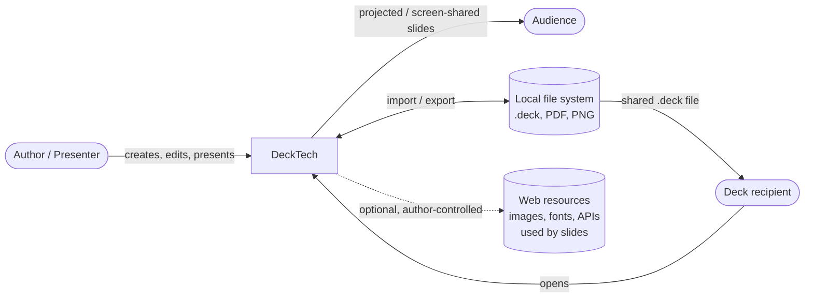
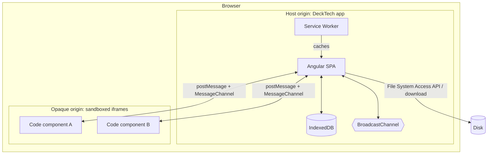

# 3. Context and Scope

## 3.1 Business context

| Partner | Input / Output |
|---------|----------------|
| Author | Edits slides and code; receives live preview. |
| Audience | Sees the presented output on a display; may also interact if the presenter lets them (e.g. via a shared screen). |
| Recipient | Receives a `.deck` file by any channel and opens it in their DeckTech. |
| Local file system | `.deck` archives (import/export), PDF/PNG exports, user-picked images and fonts. |
| Web resources | Only fetched if a slide or code component explicitly asks. The default sandbox policy blocks network access (see [8.2](08-crosscutting-concepts.md#82-security-model-for-code-components)). |

## 3.2 Technical context

| Interface | Technology | Notes |
|-----------|------------|-------|
| Host ↔ code component | `postMessage` over a dedicated `MessageChannel` per component | Versioned protocol, see [8.3](08-crosscutting-concepts.md#83-code-component-api). |
| Editor window ↔ presenter-view window | `BroadcastChannel` | Syncs current slide, step and timer. No server required. |
| App ↔ storage | IndexedDB (via a thin repository abstraction) | Decks, assets (blobs), component library. |
| App ↔ disk | File System Access API where available, otherwise download/`<input type=file>` | `.deck` is a ZIP. |
| App ↔ internet | `fetch`, only through the sandbox policy | Disabled for code components unless the deck opts in. |

## 3.3 Scope boundary

In scope: the editor, renderer, presenter, local storage, import/export, component runtime.
Out of scope: user accounts, cloud storage, collaboration server, component marketplace (all possible future extensions behind the repository and export abstractions).
