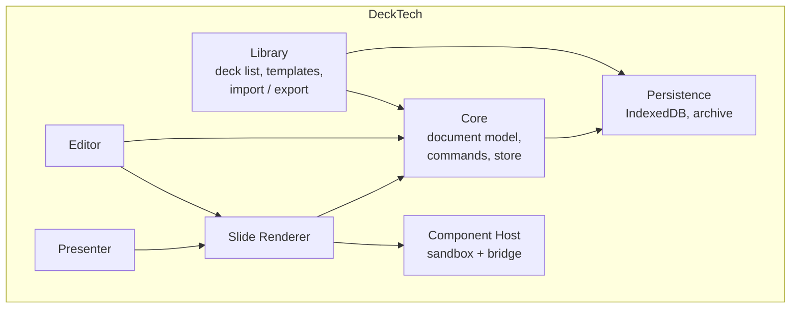
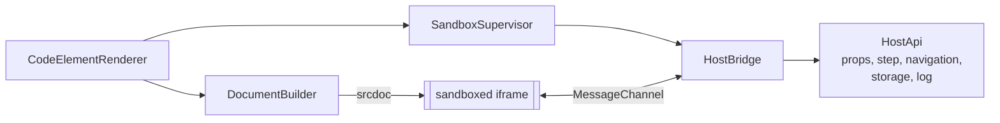

# 5. Building Block View

## 5.1 Level 1: whitebox overall system



| Building block | Responsibility |
|----------------|----------------|
| **Core** | The deck document model (TypeScript types + JSON schema), the command/undo system, the signal store, schema migrations, the `ErrorService` (`src/app/core/errors/`: the in-memory list, newest 200, of host and component errors tagged by component id; `report(source, message, componentId?)`, `forComponent(id)`; no remote telemetry, 8.9). No UI. |
| **Persistence** | `DeckRepository` with an IndexedDB and an in-memory implementation; content-addressed asset store; rolling backup store; debounced autosave with a failure banner; the hook that lets the `.deck` writer plug into the failure banner (the archive itself is in `library/archive/`, 5.8). Implemented in `src/app/core/persistence/` (see 5.6). |
| **Renderer** | Turns a slide + theme into DOM. One component per element type. Handles stage scaling and step visibility. Used read-only by presenter, thumbnails and (with an overlay) by the editor. Implemented in `src/app/renderer/` (see 5.7). |
| **Component Host** | Creates and supervises sandboxed iframes, builds their document, implements the host side of the Component API, enforces the security policy. Implemented in `src/app/components/host/` (see 5.3). |
| **Editor** | Interactive layer over the renderer: selection, transform handles, snapping, slide sorter with sections, toolbar and insert menu, properties panel, speaker notes, reading-order panel, shortcut registry and help, code editor dialog. |
| **Presenter** | Fullscreen presentation, step engine, presenter view, notes, timer, cross-window sync. |
| **Library** | Home screen: list/search decks, create from template, rename, duplicate, delete, import and export `.deck` files (one deck, or all as one ZIP); the component library is a dialog of the editor, see 5.3). Implemented in `src/app/library/` (see 5.8). |

## 5.2 Level 2: Core

| Block | Responsibility |
|-------|----------------|
| `DeckModel` | Types: `Deck`, `Slide`, `Element`, `Theme`, `Layout`, `AssetRef`, `ComponentDef`, plus `SCHEMA_VERSION`, the stage constants, the id generator and the `createDeck` / `createSlide` / `createElement` factories, plus the rich text grammar and helpers (`rich-text.ts`: `RichDoc`, `validateRichText`, `isSafeHref`, `plainToRich`, `richPlainText`, `richTokenRefs`) and the theme and layout pieces: `BUILT_IN_THEMES` (light and dark) and `createTheme`, `BUILT_IN_LAYOUTS` (Blank, Title slide, Title and content, Two columns, Title only) and `createBuiltInLayouts`, `instantiateLayout` / `createPlaceholderElement` (a slide's elements from a layout's placeholders), `reflowToLayout`, `themeRefs` (the colour tokens, font keys and type sizes a deck uses), `contrastRatio` (WCAG), `themeContrast` (text, muted and accent against the background), `effectiveFontSize` (a text's size from `sizeToken` or `fontSize`), `freePlaceholder` (the placeholder a new element of a kind would fill), `validateFill` and `validateTheme`. Implemented in `src/app/core/model/`. |
| `DeckStore` | Signal-based holder of the current deck (`@Service`). Exposes `deck()` (read-only), `currentSlide()`, `selection()`, `selectedElements()`, `canUndo()` / `canRedo()`. The deck changes only through `execute(command)`, `undo()` / `redo()` (which replay recorded patches) and `load(deck)` (opening a document; resets history; the caller runs `migrate` / `validateDeck` first). `undo()` / `redo()` apply the patch before moving the history entry, so a failing patch leaves deck and history unchanged. Selection and current slide are UI state. Implemented in `src/app/core/store/`. |
| `Command` | `{ name, coalesceKey?, do(deck) → { deck, patch, inverse } }`. `do` is pure; commands build the new deck with immutable updates and `resultOf(before, after)` derives the forward and inverse JSON patches by structural diff (referentially equal subtrees are skipped; arrays of `{ id }` objects are matched by id, so inserting or removing one slide or element is a single operation). Commands: `AddSlide`, `DeleteSlide`, `DuplicateSlide`, `ReorderSlides`, `SetNotes`, `SetSlideSection`, `SetSlideLayout` (re-flows placeholder content), `SetSlideBackground`, `SetTheme`, the layout commands `AddLayout`, `DuplicateLayout`, `RenameLayout`, `DeleteLayout` (needs a replacement when slides use the layout), `SetLayoutBackground`, `AddPlaceholder`, `SetPlaceholderBox`, `SetPlaceholderKind` and `RemovePlaceholder` (`layout-commands.ts`, rules in 8.7), `AddAsset`, `AddElement`, `DeleteElements`, `MoveElements`, `ResizeElements`, `SetProps`, `ReorderElements`, `SetText`, `SetComponentSource`, `SetComponentDef` (name, prop schema, permissions, `files`, `libs`; the result must pass `validateComponent`), `SetCodeProps` (declared props of one code element, each value checked with `propValueProblem`), `DetachComponent` (a code element gets its own copy of a shared definition), `AddCodeElement`, plus `Batch(name, commands)`, which runs several commands in order as one undo step (duplicate, paste, rotating a selection) and throws, leaving the deck unchanged, if any of them does. Invalid targets or arguments throw `CommandError` and leave the deck untouched. |
| `History` | Bounded undo/redo stacks of `{ forward, inverse }` patch pairs (default 200 entries, configurable via `HISTORY_OPTIONS`). Commands with the same `coalesceKey` issued within 500 ms of the previous one (injectable `CLOCK`) are merged into one entry whose patches are re-diffed from the start of the burst, so its size follows the net change, not the number of commands; any other command, undo or redo ends the burst. `DeckStore.beginGesture(key)` (history `hold`) keeps merging that key regardless of the window until the returned release function is called, so a gesture is one entry however long the pointer rests. No-op commands record nothing. |
| `Migrations` | Registry of pure upgrade functions `vN → vN+1` (`MIGRATIONS`, keyed by the version upgraded from) and `migrate(raw): Result<MigrationOutcome, MigrationError>`, which runs the chain on a private clone and then `validateDeck`. Documents with a newer `schemaVersion` yield a `readOnly` outcome. `migrateStored(raw, sink)` additionally hands the untouched original to a `BackupSink` (implemented by persistence) before returning a migrated deck. Implemented in `src/app/core/migrations/`. See 8.1. |
| `Validation` | `validateDeck(unknown): Result<Deck, ValidationError[]>`, a hand-written runtime validator (no schema library) applied on import and load; guards against malformed or hostile files. See 8.1. |

### Document model (simplified)

```ts
interface Deck {
  schemaVersion: number;
  id: string;
  title: string;
  stage: Stage;               // logical stage size, default 1920x1080
  theme: Theme;               // colors, fonts, spacing tokens
  layouts: Layout[];          // master layouts with placeholders
  slides: Slide[];
  assets: Record<string, AssetRef>;   // id → blob key, mime, hash
  components: ComponentDef[]; // code component definitions used by this deck
}

interface Slide {
  id: string;
  layoutId: string;
  section?: string;           // a section starts at this slide and runs to the next slide that has one
  background?: Fill;
  elements: Element[];        // array order = z-order = reading order
  notes: string;
  transition?: Transition;
}

type Element = TextEl | ImageEl | ShapeEl | LineEl | TableEl | VideoEl | CodeEl;

interface ElementBase {
  id: string;
  x: number; y: number; w: number; h: number; rotation: number;  // stage units (1920x1080)
  locked?: boolean; hidden?: boolean;
  step?: number;              // appears at this step (0 = always visible)
  placeholder?: 'title'|'body'|'image'|'footer';   // fills the layout's placeholder of this kind (8.7)
}

interface CodeEl extends ElementBase {
  type: 'code';
  componentId: string;        // → Deck.components
  props: Record<string, unknown>;   // per-instance values for the component's declared props
}

interface ComponentDef {
  id: string;
  name: string;
  html: string; css: string; js: string;   // sources, edited in the code editor
  propSchema: PropSpec[];      // typed, drives the properties panel
  permissions: Permission[];   // e.g. 'network', 'storage' (requires user consent)
  files: string[];             // asset ids the component may read with deck.assets.url (8.3)
  libs: string[];              // vendored library asset ids
}
```

Code is stored in `ComponentDef`, not in the element, so a component can be used on many slides and edited in one place; `CodeEl.props` carries per-instance data. A component can be "detached" into a unique copy (`DetachComponent`; refused when the element is the only user). Editing a shared definition changes every instance; a definition with no instance left stays in `Deck.components` until a deck-level garbage collection exists (11.2).

The remaining element and supporting types, as implemented in `src/app/core/model/types.ts`:

```ts
interface TextEl  extends ElementBase { type: 'text';  text: string; rich?: RichDoc; font?: string; fontSize: number; sizeToken?: string; color: Color; align: 'left'|'center'|'right'; }
interface ImageEl extends ElementBase { type: 'image'; assetId: string; alt: string; fit: 'cover'|'contain'|'stretch'; }
interface ShapeEl extends ElementBase { type: 'shape'; shape: 'rect'|'ellipse'|'triangle'; fill?: Fill; stroke?: Color; strokeWidth: number; }
interface LineEl  extends ElementBase { type: 'line';  stroke: Color; strokeWidth: number; }
interface TableEl extends ElementBase { type: 'table'; rows: string[][]; }
interface VideoEl extends ElementBase { type: 'video'; assetId: string; autoplay: boolean; loop: boolean; }

type Fill =
  | { kind: 'solid'; color: Color }
  | { kind: 'gradient'; angle: number; stops: { offset: number; color: Color }[] }
  | { kind: 'image'; assetId: string; fit: 'cover'|'contain'|'stretch' };

type Color = string | { token: string };   // literal CSS colour, or a key of Theme.colors
interface Stage { width: number; height: number; }   // width 1920 or height 1080
interface Transition { type: 'none'|'fade'|'slide'|'zoom'; durationMs: number; }
interface Theme { name?: string; colors: Record<string,string>; fonts: Record<string,string>; typeScale: Record<string,number>; spacing: Record<string,number>; fontFaces?: FontFaceRef[]; }
interface FontFaceRef { family: string; assetId: string; }   // an embedded font file, registered with FontFace
interface Layout { id: string; name: string; background?: Fill; placeholders: Placeholder[]; }
interface Placeholder { id: string; kind: 'title'|'body'|'image'|'footer'; x: number; y: number; w: number; h: number; }
interface AssetRef { blobKey: string; mime: string; hash: string; size: number; }
type Permission = 'network' | 'storage';
```

Colours are either a literal (`#rrggbb`, `rgb()`, `hsl()` or a keyword) or a `{ token }` reference into `Theme.colors`, and `TextEl.font` is a key into `Theme.fonts` (8.7). `TextEl.rich` (optional) is the formatted content, a restricted ProseMirror JSON document (`RichDoc`, `rich-text.ts`, ADR-004; 5.4 and 8.1 describe the grammar); `TextEl.text` is always there, as the plain text of an element without `rich` and as the plain-text mirror of the document when there is one (`richPlainText`: blocks and line breaks are lines, list items get `- ` / `1. `), so slide titles, the sorter and descriptions never parse the document. `rich` was added as an optional field without a `schemaVersion` bump (like `Slide.section`), so an older strict build rejects a deck that uses it. Element types are described declaratively in `ELEMENT_SCHEMAS` (`element-schema.ts`): per type, its fields and their kinds plus the defaults used by `createElement`. The validator and the factory both read it, so a new element type needs its interface in `types.ts` and one registry entry (quality scenario Q13). Ids are `<prefix>_<uuid>` strings (`dk`, `sl`, `el`, `cp`, `ly`, `ph`), generated with `crypto.randomUUID()` so they can be created offline and merged without coordination.

## 5.3 Level 2: Component Host



| Block | Responsibility |
|-------|----------------|
| `CodeElementRenderer` (`code-element-renderer.ts`) | `app-code-element`, the view of a `CodeEl`; the renderer loads it through `CODE_ELEMENT_VIEW` (5.7). Looks the `ComponentDef` up in the `components` input, builds the document, creates the frame and its supervisor, and keeps the frame in step with the deck. Thumbnails get a labelled placeholder and no frame; a missing definition gets a placeholder too. |
| `DocumentBuilder` (`document-builder.ts`) | `buildDocument` assembles the iframe `srcdoc`: CSP meta tag, the theme's `--deck-*` variables, user CSS, the runtime script (`deck-runtime.js`, inlined), user HTML, and user JS carried as inert JSON that the runtime runs as a module. `contentSecurityPolicy(origins)` builds the policy of 8.2. |
| `sandbox.ts` | The one place that creates a frame (`createSandboxFrame`) and the one list of sandbox tokens (`SANDBOX_TOKENS` = `allow-scripts`), with the deny-list `FORBIDDEN_SANDBOX_TOKENS` and `assertSafeSandbox`. `npm run lint:boundaries` fails on a forbidden flag anywhere in the sources and on a frame created anywhere else (4.4). |
| `SandboxSupervisor` (`supervisor.ts`) | Lifecycle of one frame: waits for `ready` (5 s), checks the sender (the frame's own window, origin `"null"`), the API version and that a port is handed out once, creates the `MessageChannel`, sends `init`, then watches the heartbeat (5 s) and the frame's `load` events (a second load means it navigated away). Reports `starting` / `running` / `unresponsive` / `failed` with a reason through `onState`; destroying it removes every listener and timer. The renderer owns the policy of when a frame exists ("Frame lifecycle" below). |
| `FrameRegistry` (`renderer/frame-registry.ts`, moved there in DT-14 so the presenter may use it) | `@Service` listing the live frames (one key per renderer instance): `count`, `register`, `release`, `has`. It is what tests and the stress measurement read to check that off-screen frames are gone. Also defines `PRELOAD_DISTANCE` (1). |
| `HostBridge` (`bridge.ts`) + `protocol.ts` | Host end of the dedicated `MessagePort`. Every incoming message goes through `parseFrameMessage`: a closed whitelist of types (`heartbeat`, `steps`, `state-set`, `state-remove`, `navigate`, `asset-request`, `log`, `error`, `snapshot`, `fetch`, `link`), no extra fields, plain JSON only (no functions, `undefined`, class instances, hostile keys; depth 32), at most 64 KiB, so a payload that does not fit is dropped before any capability sees it. 200 messages per second are accepted (plus 20 heartbeats, so a chatty component cannot starve the watchdog), the rest are dropped; 1000 drops in a window (flood) or 50 rejected messages in a window cut the frame off (`failed`). |
| `HostApi` (`host-api.ts`) | What each accepted message does: persisted `deck.state` (at most 64 keys and 64 KiB, saved 250 ms after the last change and when the frame ends), navigation (present mode only), asset bytes for the component's declared `files` and `libs` and the assets chosen in its `asset` props only, link requests (http(s) and `mailto:` only, then `LinkGuard` asks the user), the network proxy `deck.fetch`, steps, snapshot, log and error forwarding. Pure logic over injected callbacks; it touches no DOM. |
| `host-services.ts` | `@Service`s: `HostConsole` (the last 200 log and error entries, tagged by component; the data for the code editor's console panel), `ComponentPolicy` (`mayRun(deckId, def)`, the user's decision about the component's code, answered by `TrustStore` (DT-17); and which origins a `network` permission is granted for, none yet), `RuntimeSource` (fetches `deck-runtime.js` once), `LinkGuard` (confirm, at most one prompt a second, then open with `noopener,noreferrer`), `ComponentAssets` (reads asset bytes through `DeckRepository`), `ComponentStateStore` (instance state in the host's `localStorage`, in memory if that is unavailable). |
| `CodeHostEvents` | `@Service` signals between frames and the rest of the app: `stepCounts` (what components declared with `deck.steps`), `stepIndexes` (what the presenter wants shown), `navigation` (the latest request), `snapshots`. Lives in `renderer/code-host-events.ts` (moved there in DT-14: `presenter` may not import `components`, 4.4); `StepEngine` and `PresentationView` read `stepCounts` and `navigation` and write `stepIndexes`. |
| `deck-runtime.js` (`public/`) | The static script inlined into every frame. Defines the global `deck` (read-only), does the handshake, runs the component module (blob URL after an import map for the libraries), forwards `console` and uncaught errors, intercepts link clicks, `window.open` and form submits, and sends a heartbeat every second. |
| `props.ts`, `examples.ts` | `resolveProps(def, stored)` gives the component exactly its declared props, each the stored value if it fits the declared type (and range / options) and the default otherwise. `COUNTER_COMPONENT` is the built-in example (start and label props, count kept in `deck.state`). |
| `ComponentLibrary` (`components/editor/component-library.ts`) | `@Service`: the built-in examples (`BUILT_IN_COMPONENTS`: counter, bar chart, live code demo, quiz, poll, web page link) plus the components the author saved, kept through `DeckRepository.listComponents` / `putComponent` / `deleteComponent` (store `components`, entries `{ def, assets, savedAt }`, 5.6). `save(def)` takes the refs of the definition's assets from the open deck (or from `extraAssets`); `insert(entry)` copies the definition into the deck with `insertCommands`: assets the deck lacks, then `AddCodeElement`, as one `Batch` (one undo step); a library entry that differs from a definition of the deck under the same id is inserted as a new definition with a fresh id, an identical one is shared. |
| `CodeEditorDialog` (lazy, `code-editor-dialog.ts`) | The code editor (see "Code editor and component library behaviour" below): CodeMirror tabs for HTML, CSS and JavaScript, the prop schema editor (`PropSchemaEditor`), libraries and permissions tabs, a live preview in a real instance, the console panel and the accessibility checklist. |
| `CodeMirror` (`code-mirror.ts`) | `app-code-mirror`, the one file that imports CodeMirror 6: a labelled multi-line text box for one language. `npm run lint:boundaries` fails on any other import of `@codemirror/*` and on a static import of the chunk's entry points (`component-tools`, the two dialogs, this file) from outside `components/editor/`. |
| `ComponentTools`, `LibraryDialog` (lazy) | `ComponentTools` is what the `COMPONENT_TOOLS` token loads (5.7): one component that shows the code editor of an element or the component library (`LibraryDialog`: built-in examples and saved components, "Insert", "Remove"). Everything that needs CodeMirror hangs off this one chunk (`component-tools`, about 590 kB raw, 170 kB transferred), which the read-only `CodeInspector` shares. |
| `vendor.ts` | Pure helpers of "Add library" and the editor's hints: `cdnUrl`, `fetchLibrary` (npm package from the CDN, once), `readLibraryFile`, `externalImports`, `networkDependencies` (addresses the code loads from, flagged as an offline risk), `accessibilityHints`. |
| `TrustStore` (`components/trust/trust-store.ts`) | `@Service`: the user's trust decisions as the code host needs them, synchronous and reactive. `mayRun(deckId, def)` is true for a deck without a `TrustRecord` (made here) and for a component whose current hash has a `run` decision; a deck whose record is not read yet or cannot be read, a pending deck, and a changed or new component answer no (fail closed). `needsReview(deckId, components)`, `diffBase(deckId)`, `knownLibraries()`, `decide(deck, { run })` and `refresh(deckId)`. Hashes are taken once per definition object (`WeakMap`, commands replace a definition when it changes). Without a `DeckRepository` everything runs and nothing is stored (tests, tools). |
| `TrustDialog` (lazy, `trust-dialog.ts`) | `app-trust-dialog`, a modal with a focus trap. Lists every code component with the slides that use it, permissions, libraries (and how many are known), files, size and heuristic flags, a checkbox "Run …" and "Read code". Choices: **Run selected components**, **Trust whole deck**, **Open with code disabled** (all three store one decision) and **Cancel** (nothing is stored; the deck stays as it was). Marks each component *New*, *Changed since you trusted it* or *Unchanged* against the diff base. Never creates a frame. |
| `CodeInspector` (lazy, `code-inspector.ts`) | Read-only viewer used by the `TrustDialog`: tabs *Changes* (only with a diff base), HTML, CSS, JS, Props, Libraries, Files; CodeMirror in read-only mode with search, a view-only "Format" copy, the known-library check and a line diff against the last trusted version. Never instantiates a frame. Shares the CodeMirror chunk (`component-tools`) with `CodeEditorDialog`. |
| `analysis.ts`, `diff.ts`, `format.ts` | Pure helpers of the dialog: `analyzeDeck` (components, slides, libraries, files, size, `flagsOf`), `lineDiff` / `foldUnchanged`, `formatForViewing`. |

Built so far (DT-11 and DT-12, `src/app/components/host/`): `CodeElementRenderer`, `DocumentBuilder`, `sandbox.ts`, `SandboxSupervisor`, `HostBridge`, `HostApi`, the runtime and the services above. Built in DT-17 (`src/app/components/trust/`): `TrustStore`, `TrustDialog` and `CodeInspector` (lazy, in the `component-tools` chunk) and the helpers above; "Trust dialog and code inspector behaviour" below describes them. Built in DT-13 (`src/app/components/editor/`, lazy): `ComponentLibrary`, `CodeEditorDialog`, `PropSchemaEditor`, `LibraryDialog`, `CodeMirror`, the built-in examples and `vendor.ts`. How the pieces behave is described under "Component host behaviour" below; the security rules they implement are in 8.2 and the API in 8.3.

### Code editor and component library behaviour (DT-13)

- **The draft.** The dialog edits a draft (name, sources, prop schema, permissions, libraries); the deck changes only on "Done", as one `Batch`: `AddAsset` for libraries added now, `SetComponentSource`, `SetComponentDef`. That is one undo step, it changes every instance of the definition (ADR-010; the dialog says "used N times"), and a refusal by the deck (`CommandError`) is shown and the dialog stays open. "Done" is `aria-disabled` while `validateComponent` finds problems (shown in a `role="alert"` list), so the draft is validated by the rules of `validateDeck` before the deck is asked. "Cancel" and Escape ask before throwing a draft away (the question takes the focus); an Escape the editor already used (a completion list) is left alone.
- **Live preview.** A real `app-code-element` in edit mode, fed a copy of the selected element (same size and props, id `el_preview`, so its `deck.state` is separate and starts empty) and a definition that follows the draft 300 ms after the last change. Because `CodeElementRenderer` builds a fresh frame when the document changes (6.2), the preview has exactly the semantics of presenting. Prop schema edits and prop values reach the running frame without a reload. The console panel lists what `HostConsole` collected for this component (`role="log"`, focusable so it can be scrolled by keyboard), with "Clear console".
- **Code tabs.** CodeMirror 6 with HTML, CSS and JavaScript highlighting, line numbers, history, search, bracket matching and completion; each box is labelled ("HTML source"…). Tab is not captured, so the keyboard can always leave (Ctrl+] indents). The tabs are a WAI-ARIA tab list (arrow keys, Home, End, one tab stop).
- **Prop schema editor.** One fieldset per property (key, label, type, default, range for numbers, `value: label` lines for choices); changing the type resets the type-specific fields to a valid default. It is plain signals and native controls, not a Signal Form (the list is dynamic); the rules come from `validateComponent`, shown next to the dialog's actions.
- **Libraries.** "Add from a file" (`.js` or `.mjs`, at most 5 MiB) and "Download from npm once" (package name and version, validated, then `https://esm.sh/<name>@<version>?bundle`, a self-contained ES module build; jsDelivr's `+esm` build imports its dependencies from the CDN and would not work offline). The package address answers with a stub that re-exports the bundle from a root-relative path; `fetchLibrary` follows that one path on the same host once and checks the bundle. Both refuse a module that still imports from the network (`externalImports`), store the text as a `text/javascript` asset through `DeckRepository.putAsset` at once (so the preview can read it) and list it with the import name to use: `import * as lib from '<asset id>'` (a friendlier specifier is not built). The asset joins `Deck.assets` and the definition's `libs` on "Done"; removing a library only drops it from the definition. Code that names a network address in `src`/`href`, `url()`, `@import`, `import`/`import()` or `fetch` is flagged "will not work offline" (8.6).
- **Permissions.** Ticking `network` or `storage` first shows what it means in an `alertdialog` ("Allow Network?"); the permission is recorded in the draft only on "Allow". `network` still only declares the request: the origins come from `ComponentPolicy`, which grants none (the trust dialog lists the request but offers no way to allow an address yet), and the dialog says so.
- **Accessibility checklist.** Five checkboxes (not saved) and automatic hints from `accessibilityHints` (image without alt, clickable `div`, empty button, unlabelled control, animation without `prefers-reduced-motion`, removed focus outline), shown as a list under the checklist.
- **Component library.** "Components…" in the toolbar opens `LibraryDialog`; "Save to library" in the editor saves the draft (its asset refs included) under the definition's id, replacing an earlier save. Inserting copies the definition into the deck, so a deck stays self-contained; later edits of the library entry do not reach decks that already hold a copy. Entries that no longer validate are ignored when listing.
- **Chunk.** CodeMirror and the dialogs form the lazy chunk `component-tools`; the initial bundle is unchanged. The chunk rule is in `scripts/check-boundaries.mjs`.

### Trust dialog and code inspector behaviour (DT-17)

- **The gate.** `CodeElementRenderer` asks `ComponentPolicy.mayRun(deckId, def)` (a `computed`, so it follows later decisions). A component that may not run gets **no frame at all**: the document is not built, `start` refuses, and the element shows a labelled placeholder (`role="img"`, "Code component switched off: <name>", "Code switched off") in the editor, in the code editor's preview and when presenting; thumbnails never had frames. Deciding or changing a decision adds or removes frames at once. A test renders pending decks in edit and present mode and asserts that no `iframe` exists and `FrameRegistry` is empty; another drives every state of the dialog and the inspector with the slide on the page.
- **Records.** A `TrustRecord` (`meta` record `trust:<deckId>`, 5.6) is `{ deckId, sourceId, status: 'pending' | 'decided', archiveHash, decidedAt, decisions, snapshots, previous }`. *Content-bound* means each decision is `{ componentId, hash, run }` where `hash` is the SHA-256 of the canonical JSON (sorted keys) of the whole `ComponentDef`, so editing any part of a component (source, prop schema, permissions, library or file lists, name) makes it undecided again; a component with no decision for its current hash counts as undecided, and so does one added later. Slide edits do not matter. `archiveHash` is the hash of `deck.json` at import, kept for information. `snapshots` are the sources of the components the user chose to run (the base of the diff after a decision); `previous` is the same for an earlier trusted version of the source deck, found by `sourceId` at import (the base until a decision is made).
- **Who writes them.** `DeckArchive.importBytes` writes a pending record **before** it saves a deck with components (a deck without a record is trusted, so a deck must never exist without its mark) and deletes it again if saving the deck fails; if the mark cannot be written, nothing is stored. `DeckLibrary.duplicate` gives the copy of a deck the same record under the new id (otherwise duplicating an imported deck would switch its code on). `TrustStore.decide` hashes every component first and writes the record once, so a failure changes nothing. `DeckRepository.delete` removes the record.
- **Fail closed.** `TrustStore` answers no while a record has not been read, when it cannot be read (it is then treated as pending) and when a stored record is damaged (`readTrustRecord` / `trustOrPending`). The editor and the presenter call `CODE_TRUST.refresh(deckId)` (a token in `renderer/code-view.ts`, provided by `provideCodeComponents()` with `TrustStore`) before they show a deck, so a deck deleted and imported again under the same id is judged by what is stored now.
- **Asking.** After a deck has opened, `EditorShell` asks once per opened deck when `CodeTools.reviewNeeded()` (pending, or a component without a decision for its current content): it sets the request `{ view: 'trust' }`, which `ComponentTools` draws as `TrustDialog`. "Review code…" in the toolbar (shown for a deck that has a trust record, that is one that came from a file, and has components) opens it at any time, also to change a decision. Closing the dialog does not ask again for that deck until it is opened again.
- **Dialog.** Nothing is ticked for a pending deck; for a decided one the components that run are ticked. "Run selected components" needs at least one tick. Every component's source is one click away ("Read code of …") and one more click to the tab. Escape in the inspector goes back to the list (focus on the button that opened it), Escape in the list closes it; an Escape that the viewer's search box used is left alone. A decision that cannot be stored is shown in a `role="alert"` and the dialog stays open.
- **Flags** (`flagsOf`, hints from a text search, never a verdict): the `network` / `storage` permissions, `eval` / `new Function` / `Function(`, `import()`, network APIs (`fetch`, `XMLHttpRequest`, `WebSocket`, `sendBeacon`, `EventSource`), web addresses in HTML, CSS or JS (at most five shown) and lines over 500 characters or a file over 2000 characters on at most two lines (probably minified).
- **Inspector.** `CodeMirror` gained `readOnly` (read-only state, soft wrapping; the box stays focusable and searchable), `search()` and the `text` language. The diff view is drawn by Angular interpolation, not CodeMirror: `lineDiff` peels off common first and last lines and compares the middle with a longest-common-subsequence table (above 4 million cells the middle is shown as all removed then all added), `foldUnchanged` keeps three lines of context. Each changed line carries the `+` / `−` mark and a screen-reader "Added:" / "Removed:". "Format" is a heuristic pretty-printer for a view-only copy (`formatForViewing`; a regular expression literal containing a quote or brace can fool it, texts over 2 MiB are shown as they are). Libraries and files show their id (the SHA-256), size and, for text, the content on request (at most 5 MiB). A library is *known* when the same digest appears in the snapshots of any trusted decision or in `BUNDLED_LIBRARIES` (empty: the app bundles no releases yet).
- **Chunk and boundaries.** `TrustDialog` and `CodeInspector` are reached only through `ComponentTools`, so they ride in the `component-tools` chunk; `scripts/check-boundaries.mjs` treats `trust-dialog` and `code-inspector` like the other chunk entry points and lets `components/trust/` import `code-mirror`.
- **Known limits.** An approved component that is edited later (in the code editor) is undecided again, so the dialog asks once more; its live preview is gated like any frame and shows the placeholder while the component is undecided. Granting network origins is not built. The inspector's diff is per component and per section, not per word. Only the dialog's own components are compared: a component that was removed since the trusted version is not listed.

### Component host behaviour (DT-11)

- **Drawing a code element.** The renderer cannot import `components` (4.4), so the app provides `CODE_ELEMENT_VIEW` (`provideCodeComponents()` in `app.config.ts`): a loader that `import()`s `CodeElementRenderer` on the first slide with a code element, so the sandbox code is a lazy chunk (`code-element-renderer`, about 9 kB transferred) and the initial bundle does not grow. `SlideRenderer` takes the deck's `components` and `deckId` as inputs and hands them, with the theme, mode and the element map, to the view through `NgComponentOutlet`; the canvas passes them from the store. Without the provider, or without a matching `ComponentDef`, nothing (or a "Missing component" placeholder) is drawn.
- **Frame lifecycle.** The frame is built imperatively (`createSandboxFrame`): Angular refuses to bind `sandbox` and sanitises `srcdoc`, which would strip the scripts. A new frame is made when the built document changes, which it does when the HTML, CSS, JS, `permissions` (through the CSP) or the runtime change, or when the `libs` / `files` lists change, or when the author presses "Reload component" (6.2: no hot patching). Props (`resolveProps`, only sent when the resolved values differ), theme variables and the element size are sent to the running frame as `props` / `theme` / `size` messages; the theme in the document is read at build time only. Renaming the component or editing its prop schema does not reload the frame. A frame that has failed is removed from the page, not just covered. `init` carries the step the presenter is on, so a rebuilt frame resumes there. A change of render mode (edit / present) rebuilds the frame. A hidden element in the editor is dimmed, `aria-hidden` and `inert`, so its frame is not a tab stop.
- **Document.** `<meta charset>`, then the CSP, then styles and scripts; the runtime is inlined because the frame's CSP allows no external script. User HTML is placed in the body as written. User JS is not part of the markup: it is a JSON string (`<` escaped) in `<script type="application/json" id="deck-user-js">`, so no source text can close an element; the runtime reads it after `init`, adds an import map for the libraries (bare specifier = the library's asset id; the bytes arrive in `init` and become blob URLs inside the frame) and then runs the source as a module through a blob URL. CSS has `</style` neutralised. A runtime containing a closing script tag makes `buildDocument` throw.
- **Handshake.** The frame posts `ready { apiVersion }` to its parent; the supervisor accepts it only from this frame's window with origin `"null"`, once; an unsupported `apiVersion` (the host speaks the current and the previous major, `supportedApiVersions`) ends the frame with a message and hands out no port. Otherwise a `MessageChannel` is created, `port2` is transferred to the frame and `init { apiVersion, props, theme, mode, size, state, libs, permissions }` is sent on `port1`. `mode` is `edit` or `present` (thumbnails have no frame).
- **State.** `deck.state` is persisted by `ComponentStateStore` per deck id and element id, so it survives reloading the frame and the app, and a duplicated element starts empty. It is browser-local and not part of the deck: not undoable, not exported, and not removed when the element is deleted (11.2).
- **Network.** `permissions: ['network']` only says the component asks. The origins it may reach come from `ComponentPolicy.networkOrigins` (none today; the trust dialog does not grant them). With origins the CSP's `connect-src` and `img-src` list exactly those (https, or http on localhost) and `deck.fetch` exists; `deck.fetch` is proxied: URL without credentials on a listed origin, methods GET / HEAD / POST / PUT / PATCH / DELETE, no cookie / host / origin / `sec-` / `proxy-` headers, string bodies, `credentials: 'omit'`, `redirect: 'error'`, 15 s timeout, 4 requests at a time, response at most 5 MiB.
- **Frame lifecycle (DT-12, R3).** A frame exists only while it can be seen. `SlideRenderer` takes a `distance` input (slides between this slide and the one shown, 0 by default) that it hands to every code view; beyond `PRELOAD_DISTANCE` (1: the shown slide and its neighbours, so the next slide is ready) the frame is destroyed, and in the editor a frame whose element an `IntersectionObserver` reports as out of view is destroyed too (not while presenting: a preloaded slide is hidden but wanted). The owner of the slides sets `distance`: `PresentationView` (5.5) gives the shown slide 0 and a kept neighbour 1; the editor sets nothing, so everything counts as shown. A frame that comes back is a new one: it starts again from the saved `deck.state` and the current step (there is no "pause" message; destroying is the pause, 11.2). While no frame exists the element shows a labelled placeholder, never a stale error. Frames are never created in thumbnails: a thumbnail draws the snapshot the component last supplied with `deck.snapshot(blob)` (`CodeHostEvents.snapshots`, newest 25 kept, shown through an object URL that is revoked when it changes), else the labelled placeholder; this stands in for a frame pool, because a pooled live frame per thumbnail would cost what R3 is about.
- **Errors.** An uncaught error or rejection in the frame is written to `HostConsole` and `ErrorService` (source `component`, tagged by component id). The editor shows it under the component and the component keeps running; when presenting, a throwing component is replaced by the neutral placeholder and its frame is destroyed. A frame that fails to start, navigates away, floods the bridge or sends garbage is `failed` and removed; one that stops answering is `unresponsive` (reported as source `host`). Either is replaced by a message: the reason with "Reload component" and, while the frame still exists, "Skip component" (destroys the frame, keeps the notice) in the editor (`role="alert"`), a neutral "This component is unavailable." when presenting (`role="status"`, Q8), where an unresponsive frame is destroyed (a loop cannot recover; the 5 s watchdog is the bound).

## 5.4 Level 2: Editor

Implemented in `src/app/editor/`: the shell, canvas and keyboard map (DT-07) and the slide sorter, toolbar and insert menu, properties panel, notes pane, reading-order panel and shortcut registry (DT-08).

| Block | Responsibility |
|-------|----------------|
| `EditorShell` | `app-editor-shell`, the `deck/:id` route target (`id` input). Opens the deck through `AutosaveService.open(id)` (a newer route ignores a slower earlier load; a missing, invalid or read-only deck shows an alert instead of the editor) and lays out the toolbar, sorter, canvas, properties panel and notes. The `h1` is "Editor" until the deck is open, so it never shows another deck's title; the last edits are flushed when the page is destroyed. It owns the two modal dialogs (insert menu, shortcut help) and registers the editor-wide shortcuts that open them (`/`, `?`). Its document-level key handler ignores a key that something else already used, keys pressed while a dialog is open, and keys typed in a text field. |
| `Canvas` | `app-canvas`. Hosts `SlideRenderer` in `edit` mode and an interaction overlay: a layer of divs in stage units (scaled by the zoom, handle sizes and lines kept constant on screen through `--inv`) with one transparent hit target per element, in z-order, the selection frame with handles, snapping guides and the marquee. The overlay owns all pointer input, so iframes never swallow it. In "interact" mode the hit target of the one selected code element lets the pointer through; the mode ends when the selection changes. It gives the renderer the deck's `components` and id, so code elements run (as live frames) in the editor. Registers `CANVAS_SHORTCUTS` with the registry while it exists. |
| `EditorActions` | `@Service` with every non-pointer action on the selection: select all / next / previous, deselect, nudge, resize, rotate by a step, align, distribute, delete, duplicate, copy, paste, z-order, move one element in reading order, undo, redo. Each is one command (one undo step) and announces its result through `LiveAnnouncer`. Toolbar, shortcuts and panels all call it. |
| `SlideActions` | `@Service` with the slide-level actions: add (after the current slide; the layout is the one picked in `newSlideLayout`, else the current slide's, and the new slide gets an element in each of its placeholders), duplicate, `setLayout`, delete (the last slide is refused), move by a step or before a given position (`moveSlideBefore`, the drop position of a drag), set section. Each is one command and announces; a rejected command is announced, never thrown into an event handler. |
| `InsertActions`, `INSERT_ITEMS` | `@Service` that inserts the items of the table `INSERT_ITEMS` (title, bullet list, text, image, rectangle, ellipse, triangle, line, code component) into the current slide as one command, selects the new element and announces it. `insertImage(file)` stores the blob through `DeckRepository.putAsset` first and then runs `Batch(AddAsset, AddElement)`, so a failure never leaves a half-added picture; the target slide is the one current when the picture was asked for. `pickImage()` opens the browser's file chooser. After text or a picture it publishes a `focusRequest` so the properties panel can focus the text or alt-text field. |
| `ShortcutRegistry` | `@Service`, the one place shortcuts are declared: `register({ id, scope, key, ctrl?, shift?, alt?, keys, description, run })` returns the unregister function and throws `ShortcutConflictError` for a repeated id or a combination that overlaps another in the same scope or in `global` (shift left open overlaps both). `find` / `handle` look in the scope first, then in `global`; a handler returning `false` leaves the key to the browser. `shortcuts()` feeds the help. Scopes: `global`, `canvas`, `sorter`. |
| `CANVAS_SHORTCUTS` (`shortcuts.ts`) | The canvas keyboard map as data (key, modifiers, description, action); the canvas registers each entry under the id `canvas.<keys>`. |
| `ShortcutHelp` | `app-shortcut-help`: a modal `role="dialog"` listing everything in the registry by scope. Traps focus (`appFocusTrap`), closes on Escape, the backdrop or its button, and gives focus back to what opened it. |
| `ThemeActions` | `@Service` for theme changes: `applyCustom(theme)` (a `SetTheme` from the theme editor; returns `null` or the deck's reason for refusing), `applyBuiltIn(id)` (a `SetTheme` that swaps colours, type scale and spacing and keeps fonts and font files), `addFont(file)` / `pickFont()` (stores the font file, then adds asset, face and font entry in one `Batch`), and `builtInThemeId(theme)`. Announces outcomes; a rejected command is announced, not thrown. |
| `ThemeEditor` (`theme-editor.ts`), `LayoutEditor` (`layout-editor.ts`) | The two modal editors of DT-31, opened from "Edit theme…" and "Layouts…" in the toolbar by the shell (`Dialog` `theme` / `layouts`): a draft of the theme applied with one `SetTheme` through `ThemeActions.applyCustom`, and layout commands dispatched directly. Behaviour in 8.7. |
| `EditorToolbar`, `InsertMenu` | The top bar, on one row at 1280 px, in groups: Insert and Add slide, then the "New slide layout" and "Theme" selects with icon buttons for Edit theme… and Layouts…, then Present (the primary button); an overflow menu (`app-menu`, "More actions") holds Components…, Review code… (when there is code to review), Add font…, Keyboard shortcuts and the colour scheme (System / Light / Dark); the canvas keeps its own toolbar for selection tools. Icon buttons carry an `aria-label` and a tooltip with the shortcut and the insert dialog: a filter box over `INSERT_ITEMS`; typing narrows the list, Enter takes the first match, Arrow Down enters the list. A modal dialog like the help. |
| `SlideSorter`, `SlideThumb` | `app-slide-sorter`: the slide list (see below). `SlideThumb` draws `SlideRenderer` in `thumbnail` mode only while its box is near the scroll area. |
| `PropertiesPanel` (+ `field-defs`, `panel-values`, `ColorControl`, `FillControl`) | `app-properties-panel`: schema-driven sections for the one selected element, or layout and background of the slide when nothing is selected (see below). |
| `CodeProps` (`properties/code-props.ts`) | Part of the properties panel for a code element: the component's name, how many elements share it, "Edit code…" and "Detach (make unique)", and the form generated from the definition's `propSchema` (a Signal Form over the values the component currently gets, `resolveProps`). A value that does not fit its spec (`propValueProblem`) is flagged (`role="alert"`, `aria-invalid`, `aria-describedby`) and not sent; the others become one `SetCodeProps` per burst (coalesced per element and keys), and the running frame gets them as `props` messages without reloading. `asset` props offer the deck's assets. Disabled while the element is locked. |
| `CodeTools` (`code-tools.ts`) | `@Service` that holds the request to open the code editor of one element (`edit(id)`) or the component library (`openLibrary()`). The dialogs live in `components`, which the editor may not import (4.4), so the shell loads them through the `COMPONENT_TOOLS` token (5.7) and creates them imperatively; the document-level shortcuts are ignored while one is open. Opened by Ctrl+Enter, a double-click on the selected code component, "Edit code" in the canvas toolbar or "Edit code…" in the panel; "Components…" in the toolbar opens the library. |
| `NotesPane` | `app-notes-pane`: a labelled textarea for the notes of the current slide; every input is a `SetNotes` (coalesced per slide). |
| `ReadingOrder` | `app-reading-order`, inside the properties panel: the elements of the slide in order with "move earlier / later" buttons, each step one `ReorderElements`. |
| `geometry`, `snapping`, `viewport` | Pure functions, in stage units: rotated corners and bounds, `resizeBox`, `scaleInto`, `angleTowards`, align / distribute; snap targets and `snapMove`; fit / zoom-at / pan / `toStage`. |

### Editor chrome behaviour (DT-08)

- **Slide sorter.** A vertical list of thumbnails. Only the current slide is in the tab order; Arrow Up / Down, Home and End select (and focus) another slide, so a 200-slide deck is one tab stop. Enter adds a slide after the current one, Alt+Arrow Up / Down moves the slide, Ctrl+D duplicates, Delete deletes; these work only while a slide button has focus, so the section field and the tool buttons keep their own keys. Reordering by drag and drop uses the HTML drag events with a drop indicator; because dragging has no keyboard or single-pointer form, the tool row also has "Move up" and "Move down" buttons. After a keyboard action the focus goes back to the current slide's button once the list is redrawn (moving a node can drop focus). Thumbnails are drawn through an `IntersectionObserver` rooted at the scrolling list with a 240 px margin and are removed again when they leave it, so only a screenful of slides is ever rendered (Q11); without `IntersectionObserver` all are drawn. The list itself is not windowed.
- **Sections.** `Slide.section` is an optional name: a section starts at that slide and runs to the next slide that has one. "Section" opens an inline labelled form for the current slide (empty removes it, Escape cancels); the name is shown above the thumbnail and in the slide button's accessible name. A section start moves with its slide; a duplicate does not copy it (a copy continues the section); deleting the start slide removes the heading rather than handing it to the next slide.
- **Insert.** `/` (outside text fields) or the toolbar opens the insert menu. Items come from `INSERT_ITEMS`. A title or bullet list or text box is selected and the properties panel focuses its text field, so typing can start at once; a picture goes through the file chooser and then focuses the alt-text field. Positions are fixed per item (a title at the top, shapes centred); pictures are scaled down to fit 1200 x 675 and centred, never enlarged. A code component inserts a starter `ComponentDef` with a fresh id.
- **Properties panel.** Fields come from `ELEMENT_SCHEMAS` plus the shared base fields (`fieldsOf`), grouped into Position and size, Text formatting, Content, Fill and stroke and Arrangement (`sectionsOf`); kinds without an inline editor (asset, component, table, props) are skipped, and the code component's prop form is `CodeProps` (below). Scalar fields are a Signal Form (`@angular/forms/signals`) over `PanelValues`, refilled from the element whenever the selection or the element changes; an `effect` turns a difference between the form and the element into one `SetProps` (`changesFrom`), so the panel writes no state itself and a form that was just filled dispatches nothing. Number validators come from the schema (bounds, whole numbers for `step`, never beyond the validator's 1,000,000); an invalid field shows its message (`role="alert"`, `aria-invalid`, `aria-describedby`) and is left out of the command while the other fields keep working. Edits to one field in a burst share a `coalesceKey` (`panel:<id>:<keys>`), so typing is one undo step. Colours (theme token, custom colour, or none for optional ones) and fills (none or solid; a gradient or image fill from an imported deck is shown and kept but cannot be created yet) have their own controls that dispatch through the same path. A locked element's sections are `fieldset disabled` apart from Arrangement, so "Locked" can be unticked. With several elements selected the panel only counts them. With nothing selected it edits the slide: layout (through `SlideActions.setLayout`, which re-flows placeholder content and announces) and background (`SetSlideBackground`). The text content of a text element without `rich` is edited in a textarea here; once an element has formatted content the textarea is replaced by a note, because typing there would silently drop the formatting. A text element also gets the "Rich text" group (`TextFormat`, `editor/text/`, see "Rich text editing" below).
- **Notes.** One textarea for the current slide; the text shown always comes from the deck, so undo updates it.
- **Reading order.** The element array is the z-order, the DOM order and so the tab and reading order (8.8), so the panel moves an element earlier or later in that array; "earlier" also means further back. It announces the new position and keeps the focus on the button that was used (or on its sibling when that one just reached the end).
- **Escape.** On the canvas Escape cancels a gesture, then clears the selection. Anywhere else in the editor outside a dialog (a panel field, the sorter, the notes) the shell clears the selection and returns the focus to the canvas in one press, because the focus is otherwise left in a panel after an insertion and people expect Escape to deselect. Dialogs and the section form handle their own Escape and mark it as used, so it does not also reach the shell.
- **Shortcuts.** Every shortcut is declared through `ShortcutRegistry`; a conflicting registration throws when the editor opens, so a clash is found by the first test run rather than by a user. The help (`?` or the toolbar button) lists what is registered, so it cannot drift from the code.
- **Quality scenarios.** Q1 and Q2 are covered by keyboard-only tests that drive the editor with key events (10.4); the manual timing for Q1 is recorded on the pull request.

### Canvas behaviour

- **Coordinates.** The viewport is `{ zoom, panX, panY }` (UI state, not in history): `zoom` is the factor `k` of 5.7, so a pointer position is turned into stage units with `(client - area origin - pan) / zoom`. "Fit" is the default and follows the area size; 100% is zoom 1; the range is 10% to 800%. Ctrl+wheel zooms around the pointer, the plain wheel, middle-button drag or Space+drag pan, and the arrow keys pan while nothing is selected. Panning keeps at least 64 px of the slide in view.
- **Selection.** Click selects, Shift+click toggles, a press on empty space clears and starts a marquee (Shift keeps the existing selection). The marquee selects every element whose rotated bounds *intersect* it. Pressing one of several selected elements without dragging narrows the selection to it on release.
- **Move.** A press becomes a drag after 3 screen pixels. The moving bounds snap (6 screen pixels, so `6 / zoom` stage units) to the slide edges and centre and to the edges and centre of every other visible element; Alt turns snapping off. The snap lines are built once per gesture. Each pointer move issues `MoveElements` with the step since the previous one.
- **Resize.** Eight handles on a single element (in the element's own, rotated frame; the opposite edge stays put on the stage) and on a group of unrotated elements (scaled as a block with `scaleInto`; a group with a rotated member gets no handles because scaling would shear it). Shift keeps the ratio, nothing gets smaller than 1 unit, and a resize never flips. Unrotated boxes snap the dragged edges. Each move issues `ResizeElements` with absolute geometry.
- **Rotate.** A handle above a single element; the angle follows the pointer, Shift snaps to 15 degrees. It issues `SetProps { rotation }`.
- **One undo step per gesture.** Every gesture has its own `coalesceKey` and holds it open with `DeckStore.beginGesture(key)` until the pointer is released, so a pause longer than the 500 ms window still does not split it. Escape during a gesture undoes it (only if it changed the deck; a press that never moved has nothing to undo).
- **Locked elements** can be selected, copied, duplicated and reordered but not moved, resized, rotated, aligned or deleted from the editor; they show a dashed frame and no handles.
- **Keyboard** (all of it is listed in the shortcut help, `?`): Tab / Shift+Tab select the next / previous element and, past the last / first one, are left to the browser so the canvas is not a keyboard trap; arrows nudge 1 unit (Shift 10); Ctrl+arrows resize from the top-left corner; Alt+Left / Right rotate 1 degree (Shift 15); Delete; Ctrl+A / D / C / V / Z / Shift+Z / Y; `[` and `]` one step in z-order, Ctrl+`[` / `]` to back / front; `+`, `-`, Ctrl+0, Ctrl+1 for zoom; Enter edits the selected text element in place, or toggles interact mode for a code component; Escape clears the selection (and, while a text is edited, finishes the edit). Align, distribute, z-order, duplicate, delete, undo / redo, zoom and interact mode are also buttons in the canvas toolbar; buttons that cannot act use `aria-disabled`, not `disabled` (8.8).
- **Announcements.** Selection changes, deletes, pastes, alignments and cancelled gestures are spoken through the live region ("Text “Hello”, 2 of 5, selected", "3 elements selected"). Marquee selection is announced when the marquee ends, not for every intermediate state.
- **Copy and paste** use an in-app clipboard (a structured clone, tied to the deck id, so nothing is pasted into another deck where a code element could dangle). Duplicate and each paste shift the copies by 20 units further, give them fresh ids, add them to the current slide as one `Batch` and select them.

### Rich text editing (DT-10)

- **Document.** `core/model/rich-text.ts` describes what a text element may contain and has no dependency on ProseMirror: `doc` of blocks `paragraph`, `heading` (level 1 to 3), `bullet_list` and `ordered_list` (items are a paragraph followed by optional nested lists, at most 8 deep); inline `text` and `hard_break`; marks `bold`, `italic`, `underline`, `code`, `link` (`href`: `http(s):` or `mailto:` only, 2048 characters at most, no whitespace, quotes, angle brackets or control characters), and `color` / `size` whose `token` names a key of `Theme.colors` / `Theme.typeScale`. `validateRichText` is the only reader of untrusted content: unknown nodes, marks, attributes and fields are errors, a mark type may appear once per text node, and the document is capped at 20,000 nodes and 200,000 characters. `validateDeck` runs it for `TextEl.rich` (field kind `rich` in `ELEMENT_SCHEMAS`, so errors carry paths like `slides[0].elements[1].rich.content[2].type`); `SetText` runs it with the deck theme.
- **Commands.** `SetText(id, string | RichDoc)`: a string is plain text and removes `rich`; a document is validated, stored as a copy and mirrored into `text`. `SetProps` cannot set `rich`, and editing `text` through it removes a stale `rich`. `SetTheme` refuses a theme that drops a colour token or a `typeScale` key that text marks still use (`themeRefs` returns them as `colors` and `sizes`).
- **Editor** (`src/app/editor/text/`). Clicking a text element that is already the only selection (a press and release without a drag, with the caret placed at the click), pressing Enter, typing a character that is not a shortcut (the character becomes the first typed text; keys typed while the chunk loads are kept), or "Edit text" in the panel starts `TextEditing` (a service holding the element id, the format of the selection and a handle on the running editor, with no ProseMirror in it). The canvas then draws `TextEditor` inside the overlay, which is the scaled stage, so the editor sits exactly over the element at any zoom with no coordinate maths, and the renderer hides the rendered copy meanwhile (`SlideRenderer.concealedId`, `visibility: hidden`). `TextEditor` loads `rich-editor.ts` with `import()`; that file and `rich-schema.ts` are the only ones that import ProseMirror (`prosemirror-model`, `-state`, `-view`, `-commands`, `-history`, `-keymap`, `-schema-list`; `-transform` comes with them), so the editor is its own chunk and neither the initial bundle nor the presenter contains it (`npm run lint:boundaries` fails on any other import of ProseMirror or a static import of the chunk). The schema is built from the same constants as the grammar, and a test checks that every document one accepts the other does too.
- **Lifecycle.** While focused, ProseMirror's own history handles Ctrl+Z / Y and nothing reaches the deck. The edit ends on blur, Escape, or when the selection moves elsewhere or the element goes away; the content is then compared with what the edit started from and, if it changed, committed as exactly one `SetText` (so one undo step, and undo restores the previous content, plain or formatted). Escape also returns focus to the canvas. Focus moving into the panel's format group (marked `data-keeps-text-editing`) does not end the edit, and pointer presses on its buttons are kept from taking focus; focus leaving the group for anything but the text or the group ends it, while the whole window losing focus (Alt+Tab) ends nothing. If the deck refuses the commit, the editor stays open once and the next attempt to leave discards the text. The editor's own plugin refuses changes that would exceed the format's limits (`RICH_LIMITS`), announcing it. Keys typed in the text do not reach the canvas shortcuts or the global ones (the editor stops them), and the text shortcuts (Ctrl+B / I / U / `, Ctrl+K, Ctrl+] / [, Shift+Enter, Ctrl+Z / Y, Escape) are listed in the shortcut help under "While editing text" (`TEXT_SHORTCUTS`; the registry refuses a clash). An element without `rich` starts from `plainToRich(text)`, as one heading with line breaks when its font is `heading` (the renderer also outputs such text as one heading); an invalid stored document starts as an empty paragraph rather than failing.
- **Format controls.** `TextFormat` in the properties panel: bold, italic, underline, code, block style (paragraph, heading 1 to 3), bulleted / numbered list, indent / outdent, text colour and size (theme tokens), and a link field (Ctrl+K moves focus there; a bare "example.com" becomes `https://example.com`, an unsafe address is refused with a message). Without a running edit the group only offers "Edit text".
- **Paste.** The editor schema's parse rules are the filter: pasted HTML is reduced to the allowed nodes and marks, `<h4>` to `<h6>` become level 3, links with an unsafe address lose the link and keep their text, and styles, classes, event handlers, scripts, images, tables and forms do not survive. Colour and size are never read from pasted content. No HTML string is ever assigned to the page; what the editor shows is built by ProseMirror from its schema.
- **Rendering.** `richToView` (renderer, pure) turns the document into a tree of a fixed set of tags (`p`, `h1`-`h3`, `ul`, `ol`, `li`, `strong`, `em`, `u`, `code`, `a`, `span`, `br`, text); `TextElement` draws it with one template per tag, so a document cannot introduce any other tag, attribute or style. Links are re-checked there (`rel="noopener noreferrer"`, `target="_blank"`), colour and size marks become `var(--deck-color-*)` / `var(--deck-type-*)` references only, and an unknown node renders as nothing. `RICH_TEXT_CSS` is shared by the renderer and the editor (the editing surface carries the `rich` class itself) so editing looks like presenting; blocks have no extra spacing and headings do not change weight, as plain text never had, and the element's font size is the size of a level 2 heading (level 1 is 1.25 times, level 3 is 0.9 times), so converting a title to formatted text does not change how it looks. The overlay of the only selected, unlocked text element shows a text cursor; a drag from it still moves the element (a double-click is not used, because the canvas captures the pointer on press).

## 5.5 Level 2: Presenter

| Block | Responsibility |
|-------|----------------|
| `PresenterPage` (`presenter-page.ts`) | The route `deck/:id/present`: opens the deck, shows a message when it cannot, and hosts `PresentationView`; leaving returns to the editor. |
| `PresentationView` (`presentation-view.ts`) | Fullscreen stage; navigation by keyboard, click, touch, clicker; slide transitions; live region and controls. Inputs `deck`, `start`; output `exited`. |
| `StepEngine` (`step-engine.ts`) | Pure bookkeeping over signals, no DOM. `planSlide` / `viewAt` compute steps per slide from element `step` values and from the steps code components declared (e.g. "this component has 4 internal steps"); `next()` / `prev()` consume component steps before changing slide. |
| `Preloader` (`preloader.ts`) | `slidesToMount`: which slides stay in the page (the shown one and neighbours with code components), so the next slide's frames are ready; the rest are destroyed. A rule, not a service. |
| `PresenterView` (`presenter-view/presenter-view.ts`) | Second window: current slide, next slide preview, notes, timer, step indicator, Previous / Next and timer buttons. Mirrors the `state` the presentation window sends; sends `command` and `timer` messages. Input `deck`. |
| `PresenterViewPage` (`presenter-view/presenter-view-page.ts`) | The route `deck/:id/presenter-view`: opens the deck like `PresenterPage` (never edits it) and hosts `PresenterView`. |
| `PresenterSync` (`presenter-view/presenter-sync.ts`) | `@Service`: `connect(deckId, onMessage)` opens the `BroadcastChannel` `decktech.presenter.<deckId>` and returns a `SyncConnection` (`available`, `post`, `close`). Every incoming message goes through `parseSyncMessage`; what fails is dropped and counted in `rejected`. |
| `sync-protocol.ts` | The messages (version `SYNC_VERSION` = 1) and `parseSyncMessage`. |
| `PresenterTimer` (`presenter-view/presenter-timer.ts`) | The talk's clock: time counted plus the moment it last started, so nothing ticks; `apply('start' / 'pause' / 'reset')`, `snapshot()`. |

### Presentation behaviour (DT-14)

- **Entry and exit.** "Present" in the editor toolbar and F5 (`global.present`) open `deck/:id/present?slide=n`, `n` being the slide being edited. `PresenterPage` opens the deck the way the editor does (`AutosaveService.open`, so pending edits are saved first and nothing is read twice) and hands it to `PresentationView`; a deck that cannot be opened, or is read-only, shows a message and a link back. `?slide=` is 1-based and clamped to the deck. Escape, the Exit button or the browser leaving fullscreen emit `exited` (once), and the page returns to the editor of the deck.
- **Steps.** `planSlide` gives a slide one step per distinct element `step` value above 0 (values 1 and 5 are two presses, not five; hidden elements cost none), then, in z-order, the internal steps each visible code element declared with `deck.steps(n)`. `viewAt` turns a step into what to draw: the highest element step (`ALL_STEPS` once the element steps are spent) for the renderer, and for each component the internal step it is on. `StepEngine` holds the position (slide, step) in a signal: `next()` moves one step, then to the next slide's step 0; `prev()` takes a step back, then lands on the *last* step of the slide before; both return `false` at the ends, and `first()`, `last()`, `goTo()` and `goToSlideId()` jump (`last()` shows everything). Counts come from running components and can change under the position, so every read clamps the step to what the slide has now (a frame that died takes its steps with it; a count that grows later while the position is "at the end" keeps it at the end). A count that is not a whole number from 0 up is ignored.
- **Components.** The view writes the internal step of each component of the shown slide to `CodeHostEvents.stepIndexes` (the map is replaced as a whole and cleared on close); the frame hears it as `deck.onStep(i)`. A component's own `deck.navigate.next / prev / goTo` is published through `CodeHostEvents.navigation` and followed only if the element is on the shown slide (a preloaded component may ask while it starts and is not heard) and only if the request is newer than the presentation (`seq` of a request made before it began is ignored). `next` goes through `StepEngine.next()`, so the steps of the slide are spent first.
- **Preloader.** `slidesToMount(slides, current)` is the whole rule: the shown slide, plus the neighbours within `PRELOAD_DISTANCE` that have a visible code element. Those are drawn in the same cell as the shown slide, `visibility: hidden`, `inert` and `aria-hidden`, so their frames start at full size while the audience looks at the shown slide, with `distance` 1; the slide is the same renderer instance when it becomes the shown one (layers are tracked by slide id), so advancing flips a class and nothing is rebuilt. A neighbour without code is cheap and drawn on demand. A slide farther away is not in the result, its renderer is destroyed and with it its frames (R3). An earlier neighbour is drawn with every step revealed, a later one at its start.
- **Input.** Next: ArrowRight, ArrowDown, PageDown, Enter, Space; previous: ArrowLeft, ArrowUp, PageUp, Backspace, Shift+Space; Home and End jump; Escape exits. Keys with Ctrl, Alt or Meta, a key another handler used, and Enter or Space on a focused button or link are left alone (the control gets them); arrows still work with the focus on a control. A click on the slide advances; on touch a horizontal move of at least 50 px (and more than 1.5 times the vertical one) is a swipe, and the click that follows it is ignored. Past the last step "next" stays and announces "End of the presentation. Press Escape to leave.".
- **Fullscreen.** The view's own element requests fullscreen after the first render (the route is entered from a click or F5, which is the user gesture the browser wants). If it is refused or unavailable the view still fills the window (`position: fixed`), and Escape leaves. When the browser takes the view out of fullscreen (Escape, F11) that ends the presentation; leaving or destroying the view leaves fullscreen. The slide is the largest box of the stage's aspect ratio that fits the screen (`min(100vw, 100dvh * ratio)`); the renderer scales the stage to it.
- **Transitions.** The slide that comes in plays its own `Transition` (`fade`, `slide`, `zoom`; `none`, a length of 0 or less, and the first slide shown play nothing) as a CSS animation, capped at 5 s; the slide that goes stays visible under it for that long (`leaving`), then its layer goes if it is not a preloaded neighbour. `prefers-reduced-motion: reduce` turns all of it off, both through `matchMedia` (a signal, so a change while presenting counts) and a media query.
- **Accessibility.** The view is a labelled `region` (deck title) with a hidden `h1`; its own polite live region (`role="status"`) says "Slide 2 of 5" and, when the slide has steps, "Slide 2 of 5, step 1 of 3". It is inside the view rather than the app shell's `LiveRegion` because only the fullscreen element is sure to be in the accessibility tree. Slides that are not shown are `inert` and `aria-hidden`. A control group (Previous, Next, Exit; `aria-disabled` at the ends, like elsewhere) fades in on pointer movement and while it has focus, and is always in the tab order.
- **No network.** The view and page use no `fetch`, XHR, beacon or socket; state is the deck already in the store, assets come from IndexedDB through the renderer. A test stubs all four and walks a deck with code elements through every key.

### Presenter view and cross-window sync (DT-15)

- **Messages** (all `{ v: 1, type, ... }`): `state { slide, step, steps, slides, timer: { running, elapsedMs } }` (presentation window to presenter view), `hello` (a window asks for a `state`), `command { action: 'next' | 'prev' }` or `{ action: 'goTo', slide, step }`, `timer { action: 'start' | 'pause' | 'reset' }` (presenter view to presentation window). `parseSyncMessage` accepts only the known version, type and action, whole numbers from 0 to 100 000, a `step` within `steps` and a `slide` within `slides`, a finite `elapsedMs` from 0 to 10^11, and returns a message rebuilt from the known fields only (a `__proto__` or extra key does not travel on; inherited properties are not read). Anything else yields `null`.
- **One source of truth.** The presentation window's `StepEngine` owns the position and its `PresenterTimer` owns the clock. It posts a `state` whenever slide, step, step count or slide count change, and after every timer message; it answers `hello` with a `state`. The presenter view never changes its own copy: a click on Next sends `command { next }` and shows the position when the echo arrives, so the windows cannot disagree and either can navigate (the presentation by its keys, the view by its buttons and the same keys). Commands go through `advance()` / `prev()` / `goTo()`, so the steps of a slide are spent before it moves on.
- **Reopening.** A presenter view that is opened or reloaded sends `hello` and gets the slide, step and clock back; the timer lives in the presentation window, so reloading the view loses nothing. The clock starts when the presentation starts and can be paused and reset from the view; the view extrapolates the running time between messages and refreshes it every 250 ms.
- **Opening the window.** The "Presenter view" button of the presentation (in its controls) calls `window.open` with the same-origin route and `noopener`. The windows share nothing but the channel, so this works under `Cross-Origin-Opener-Policy: same-origin` and when the browser severs the opener. Opening a window can make the browser leave fullscreen; for 2 s after the button was pressed that change does not end the presentation (the view keeps filling the window). The presenter view also works when opened first (it shows "Waiting for the presentation") or by its URL alone.
- **Previews.** Current and next slide are `SlideRenderer` in `thumbnail` mode, not `present`: the same omission of hidden and not yet reached elements, but static and out of the accessibility tree, so no second copy of the code components runs in the presenter window (a code element is drawn from its snapshot or placeholder, as in the sorter). The current slide is drawn at the element step the position implies (`viewAt(planSlide(slide, () => 0), step)`; the internal steps of code components are not known in this window and are not drawn). The next preview is the next slide at step 0, or "End of the presentation". Notes are shown as text, line breaks kept. The step indicator reads "Slide 2 of 5, step 1 of 3" in a polite live region; the clock is `role="timer"` (not announced every second).
- **Limits.** `BroadcastChannel` is per origin and browser profile. Two presentation windows of the same deck would both answer commands. The presenter view is not told when the presentation ends and keeps showing the last position. A missing `BroadcastChannel` is reported in the view (`available` is false).

## 5.6 Level 2: Persistence

All in `src/app/core/persistence/`; the dependency rule of 4.4 holds (it uses only `model`, `migrations` and `store`).

| Block | Responsibility |
|-------|----------------|
| `DeckRepository` | Abstract class (also the DI token): `list()`, `load(id)`, `save(deck, expectedRevision)`, `delete(id)` (also removes the deck's trust record), `putAsset(blob)`, `getAsset(id)`, `getTrust(deckId)` / `listTrust()` / `putTrust(record)` / `deleteTrust(deckId)` (the trust records of 6.4, `core/persistence/trust.ts`: `getTrust` is `null` for a deck made here and a pending record for a stored one that is damaged), plus `listUnexported()` / `markExported(id, revision?)` (export reminders, 7.4; with a revision the mark stays if a newer save happened after the export) and `listBackups(deckId)`. No method rejects: every one returns `Result<T, PersistenceError>` (`not-found`, `conflict`, `read-only`, `invalid`, `quota`, `storage`); `load` additionally carries the `MigrationError`s of `migrateStored`. |
| `IndexedDbDeckRepository` | The production implementation on `idb`; also the `BackupSink`. Object stores: `decks` (`{ id, deck }`), `assets` (`{ hash, mime, data }`), `components` (the component library: `{ id, entry: LibraryComponent }`, `LibraryComponent = { def, assets, savedAt }`; read back through `validateComponent`, so a stored entry that does not validate is left out of the list), `meta` (small per-deck records `summary:<id>`, `unexported:<id>` and `trust:<id>`) and `backups` (pre-migration copies, index `byDeck`). |
| `InMemoryDeckRepository` | Same contract on `Map`s (structured clones, like IndexedDB), for tests and as the reference for the contract suite that runs against both implementations. |
| `AutosaveService` | `@Service` that keeps the open deck in sync with the repository: `create(deck)` and `open(id)` (both save the current deck first and refuse to replace it while that fails, unless forced), `flush()`, `status` (`saved` / `saving` / `error`), `error`, `persisted`, `requestPersistence()`, `exportDeck()`. See 8.5. |
| `PersistenceBanner` | `app-persistence-banner`: `role="alert"` notice inside a labelled `section` landmark, shown while `status() === 'error'`, with "Try again" and (when an export handler is provided) "Download .deck". Lives in `core` because the issue scoped it there; move it to `shared/` if a second consumer needs it. |
| `DECK_EXPORT_HANDLER` | Typed hook (`(deck) => void \| Promise<void>`, default `null`) through which the `.deck` writer plugs into the banner; `provideDeckArchive()` (5.8) provides it in the app. |
| `provideDeckPersistence()` | Environment providers for the app: the IndexedDB repository and an initializer that requests persistent storage. |

## 5.7 Level 2: Renderer

All in `src/app/renderer/`; it uses only `core` (4.4).

| Block | Responsibility |
|-------|----------------|
| `SlideRenderer` | `app-slide-renderer`. Inputs `slide`, `theme`, `layout` (optional), `mode` (`edit` / `present` / `thumbnail`, default `present`), `step` (default: all revealed) and `stage` (default 1920x1080; pass `deck.stage`), and for code elements `components` (the deck's `ComponentDef`s) and `deckId`. Draws the slide on a stage of the logical size and scales it with `transform: scale(k)`, `k = containerWidth / stageWidth`, where the width comes from a `ResizeObserver` on the host (exposed as `scale()`; 0 until the host has a width). The host takes the width of its container and keeps the stage aspect ratio, so the caller sizes it. Theme tokens are set as custom properties on the stage; the slide background, else the layout's, else the theme `background` colour, is drawn by the stage. |
| `ElementView` and `TextElement`, `ImageElement`, `ShapeElement`, `LineElement` | One component per element type. The abstract base takes the slide's element map, the element id and the theme, selects its element in a `computed` and sets position, size and rotation on its host. The map changes with every slide change but an untouched element keeps its identity, so only the element whose props changed re-renders (the `RENDER_PROBE` token lets tests count this). Table and video elements are not rendered yet; code elements are drawn by the component host (5.3) through `CODE_ELEMENT_VIEW`. `TextElement` draws `TextEl.rich` when present (`richToView`, see "Rich text editing") and otherwise the plain `text`; `textStyle` (font, size, alignment, colour of the element's box) is shared with the in-place editor. |
| `isElementShown` | Visibility rule. `present` and `thumbnail` leave hidden elements and elements with `step` above the current step out of the DOM, so they are also out of the accessibility tree. `edit` keeps every element so it can be selected; hidden ones get a `ghost` class (dimmed) and `aria-hidden`. |
| `CODE_ELEMENT_VIEW` (`code-view.ts`) | Injection token for a loader (`() => Promise<Type>`) of the component that draws a code element. `core` and `renderer` may not import `components` (4.4), so the renderer asks for the view instead; the view takes the inputs of `ElementView` plus `mode`, `components`, `deckId` and `ghost`. No provider, no code elements. |
| `theme.ts` | `themeVars` (`--deck-color-*`, `--deck-font-*`, `--deck-type-*`, `--deck-space-*`), `resolveColor`, `resolveFont`, `fillStyle`. Commands do not check structured values (8.4), so everything that reaches a style declaration is re-checked here: colours must match the validator's literal pattern or be an existing token, unsafe keys and font values are skipped, and anything else is dropped. |
| `FontFaces` | `@Service` that registers `Theme.fontFaces` with `FontFace` and `document.fonts` once the font blob has been read (it reads the `AssetUrls` signal, so the renderer's `effect` retries), once per family and asset; a failed load is forgotten, the stack falls back to the next family, and the faces are removed on destroy. A no-op where `FontFace` does not exist. |
| `AssetUrls` | `@Service` turning an asset id into an object URL signal through `DeckRepository.getAsset` (ids are content hashes, 8.5; other ids are never looked up). A failed or rejected read is forgotten so the next read retries; successful URLs are kept (and revoked) until the service is destroyed, so there is no eviction for assets a deck stops using. Without a repository the image shows a placeholder (labelled by `alt`, hidden from assistive technology when `alt` is empty). |
| `COMPONENT_TOOLS` (`code-view.ts`) | The same idea for the code editor and the component library: a loader of the lazy `ComponentTools` component (inputs `view`: `'edit'` or `'library'`, and `elementId`; output `closed`), provided by `provideCodeComponents()`. Without it the editor offers no code tools. |
| `parseText` | The renderer's name for `parsePlainText` in `core/model/rich-text.ts`: splits plain element text into paragraphs and bullet lists; text without `rich` in the theme `heading` font becomes one `h2`, however many lines. Rich editing starts from the same split (`plainToRich`). |
| `richToView`, `RICH_TEXT_CSS` | Pure mapping of a rich document to the fixed tag tree `TextElement` draws, and the stylesheet shared with the editor. Needs no ProseMirror. |

Decisions where the model left room: images are plain `img` elements, not `NgOptimizedImage`, because their sources are object URLs; the triangle shape is clipped and so has no stroke; there is no rounded rectangle (not in the model). Thumbnails are `aria-hidden` and `inert`.

## 5.8 Level 2: App shell, Library and Shared

| Block | Responsibility |
|-------|----------------|
| App shell (`app.ts`, `app.html`, `app.routes.ts`) | A skip link, the `PersistenceBanner`, a `main#main-content` landmark (`tabindex="-1"`; after every navigation except the first the shell focuses the new page's `h1`, else the landmark) around the `router-outlet`, and the live region. Routes: `''` library, `dev/stress` (only in dev mode, see 10.3), `deck/:id` editor, `deck/:id/present` presenter, `deck/:id/presenter-view` presenter view, anything else redirects to `''`. All are lazy; `withComponentInputBinding()` hands `:id` to the page as an `id` input. The editor route shows `EditorShell` (5.4); `deck/:id/present` is the presentation (`PresenterPage`, 5.5); `deck/:id/presenter-view` still shows a placeholder page (`PresenterViewPage`) with a link back to the library. |
| `DeckLibrary` | `@Service` behind the home screen. `decks()` (summaries from `DeckRepository.list()`, newest first), `status()` (`loading` / `ready` / `error`), `busy()`, `templates`, and `refresh`, `createBlank`, `createFromTemplate`, `rename`, `duplicate`, `remove`, each returning a `Result<_, { message }>` that is fit to show. `duplicate` also copies the deck's trust record to the copy (6.4), or the copy would run code the original may not. Operations are queued and run one at a time (`busy()` turns on synchronously, so buttons disable before the first one starts). Storage is written first and the list refreshed only after it accepted the change, so a failure leaves the list as it was; a failed refresh after a successful write does not turn the write into an error. `rename` and `duplicate` load the deck through the repository (so a stored older version is migrated and backed up as usual) and refuse a read-only deck from a newer version; `remove` allows it. `rename` saves with the loaded revision, so a change from another tab comes back as a `conflict` message. A duplicate changes only the deck id (other ids are scoped to their deck and assets are shared by hash) and is titled `Copy of <title>`. Titles are trimmed, non-empty and at most 200 characters (`checkTitle`). |
| Templates (`templates.ts`) | `BUILT_IN_TEMPLATES`: plain deck JSON (title and bullets, sections, big statement). `instantiateTemplate` clones the JSON, gives it a fresh deck id and runs `validateDeck`, so a malformed template is an error rather than a stored deck. |
| `LibraryPage` | `app-library-page`. Search (case-insensitive substring of the title), create actions, and the list: a thumbnail placeholder (the title's initial, `aria-hidden`), the title as a link to the editor, the modified date in a `time` element, and Rename / Duplicate / Delete buttons whose accessible names include the deck title. Rename is an inline labelled form; delete asks in an `alertdialog` that traps focus and closes on Escape; on failure it stays open with the reason, and on Cancel focus goes back to the row's Delete button. Buttons are not `disabled` while an operation runs (that would drop keyboard focus); they get `aria-disabled` and the handlers ignore the click. After each action focus moves to an element that exists (the heading when the target row is gone) and successes are announced; failures appear in a `role="alert"` banner, which is announced by itself. Creating a deck navigates to its editor route. |
| `DeckLibrary` files | `importFile(file)`, `exportDeck(id)`, `exportAll()` and `pickFile()` (not queued: a dialog can stay open for long) delegate to `DeckArchive`. Import and export run through the same queue as the other operations. An import of a deck with components also stores its pending trust record before the deck (6.4); an import refreshes the list; an export does not change it. |
| `library/archive/` | The `.deck` format (8.2 "As built (DT-16)", 8.5): `format.ts` (entry names, `Manifest`, `ArchiveLimits`, `ArchiveError`, the mime-to-extension table), `sniff.ts` (content check per mime type), `reader.ts` (`readArchive`), `writer.ts` (`writeArchive`), `file-access.ts` (`FileAccess`: save / open pickers or download / `<input type="file">`, `FILE_ENVIRONMENT` for tests), `deck-archive.ts` (`DeckArchive`: `exportStored`, `exportAll`, `exportOpenDeck`, `importFile`, `importBytes`, `pickFile`; file names by `fileStem`) and `providers.ts` (`provideDeckArchive()`, which sets `DECK_EXPORT_HANDLER`). `archive-fixtures.ts` holds the test helpers (valid decks, ZIP surgery). Uses `fflate` (ADR-007). |
| `LibraryPage` files | "Import deck…" and "Export all decks" under "Files", an "Export" button per row (accessible name with the deck title), and a polite notice that says what was imported or where the export went; an imported deck with code says so and links to the deck instead of opening it. Failures use the existing `role="alert"` banner. |
| `shared/` | `LiveAnnouncer` + `app-live-region` (one polite `role="status"` region; the message is cleared first so repeated text is announced again, and a newer announcement replaces a pending one), `FocusTrap` (`appFocusTrap`: initial focus on `[data-autofocus]` or the first control, Tab wrap, focus restored on destroy) and `app-skip-link`. `shared` depends on nothing. |
| `shared/` visual design | `ColorScheme` (`@Service`: `mode()` of `light` / `dark` / `system`, `set(mode)`; stored under `decktech.colorScheme`, applied as `data-theme` on `<html>`) and `app-color-scheme-switch` (a labelled select). The tokens and base layer are `src/styles.css`; see 8.11. The default is `system`. The editor puts the choice in the overflow menu of its top bar, the library page has `app-color-scheme-switch` in its header. |
| `shared/` primitives | The classes of `src/ui.css` (buttons, controls, tabs, badge, notice, kbd, dialog shell) and the components `app-icon` (`ICONS`, one inline-SVG icon set), `appTooltip` (`Tooltip`, with an optional shortcut hint), `app-dialog`, `app-tabs` (`tabId` / `panelId`) and `app-notice`. `uniqueId(prefix)` makes ids for ARIA links. `app-menu` is the overflow / dropdown menu (WAI-ARIA menu button). Described in 8.11. Every screen uses them. |

Decisions where the issue left room: the list is not virtualised by a scroller. It draws 60 decks and adds 60 more on "Show more" (a real button, keyboard operable, reset by a new search), and rows use `content-visibility: auto`, so a long list opens fast without a windowing library that would hide rows from keyboard and assistive technology. Thumbnails are placeholders because `library` may not import `renderer` (4.4); rendering real slide thumbnails here needs the rule to change or a thumbnail provider in `shared`, and is recorded in 11.2. The library reads and writes through `DeckRepository` directly and never touches `DeckStore` or `AutosaveService`.

## 5.9 Level 2: MCP server (DT-46)

A separate program in `mcp/` (ADR-013), outside `src/app` and outside the dependency rule table of 4.4: it imports only pure files of `core`, `library/archive` and `components/trust/analysis` by relative path, never the Angular services. Built by `npm run build:mcp`, type-checked by `npm run typecheck:mcp`, tested by `npm run test:mcp` (Vitest, real files in a temporary folder).

| Block | Responsibility |
|-------|----------------|
| `main.ts`, `server.ts` | Stdio entry (`DECKTECH_WORKSPACE`, `DECKTECH_LIBRARY` from the environment) and the adapter from the `TOOLS` list to `McpServer.registerTool`. `callTool` turns `ToolError` / `CommandError` into `isError` results and anything unexpected into a message without a stack trace. |
| `Workspace`, `DeckSession` (`workspace.ts`) | Open decks (at most 20) by deck id. A session holds the immutable `Deck`, the bytes of its assets and undo/redo stacks of earlier documents (200). `apply` runs commands as one `Batch`, checks `validateDeck` and only then commits. |
| `paths.ts` | `resolveInside(root, path)`: relative to the workspace folder, symbolic links followed (also for a file that does not exist yet), refusing a result outside it. |
| `tools/deck.ts` | `create_deck`, `open_deck`, `list_decks`, `close_deck`, `get_deck` (outline or full), `set_deck_metadata`, `export_deck`, `undo`, `redo`. |
| `tools/slides.ts` | `add_slide` (instantiates the layout's placeholders), `duplicate_slide`, `delete_slide`, `move_slide`, `set_layout`, `set_speaker_notes`. |
| `tools/elements.ts` | `add_text`, `set_text`, `add_image` (file in the workspace: extension, magic-number check, SHA-256 asset, alt text or `decorative` required), `add_shape`, `update_element`, `move_element`, `delete_element`, `set_z_order`, `set_alt_text`, `check_accessibility` (missing alt, empty text, text contrast against the slide background). |
| `tools/components.ts` | `create_component`, `update_component` (reports `instances` and `usedOn`), `list_components`, `get_component`, `insert_code_element`, `update_code_element_props` (`SetCodeProps`), `detach_component`, `validate_component`, `save_to_library`, `import_from_library`. |
| `component-check.ts` | `checkComponentDef`: `validateComponent`, acorn parse as an ES module, heuristic sandbox warnings and the trust flags. Reads source only; `executed` is always `false`. |
| `library.ts` | `FileLibrary`: `<id>.json` `LibraryComponent` records, written atomically, damaged files ignored, entries with asset files refused. |
| `tools/schema.ts` | `describe_schema`: overview, element fields (from `ELEMENT_SCHEMAS`), layouts, themes, the component API and the limits. |

Decisions where the issue left room: file-based rather than driving the app; a colour that is a theme token name stays a token, anything else must be a CSS colour; `add_slide` keeps the sample text of the placeholders (the agent replaces it with `set_text`); `set_reading_order` is `set_z_order` because the array order is the reading order (8.8); `import_deck` is `open_deck`; the library is a file folder separate from the browser's. Not built: `render_preview` and executing `validate_component` (they need a browser), tables, video and line tools.
