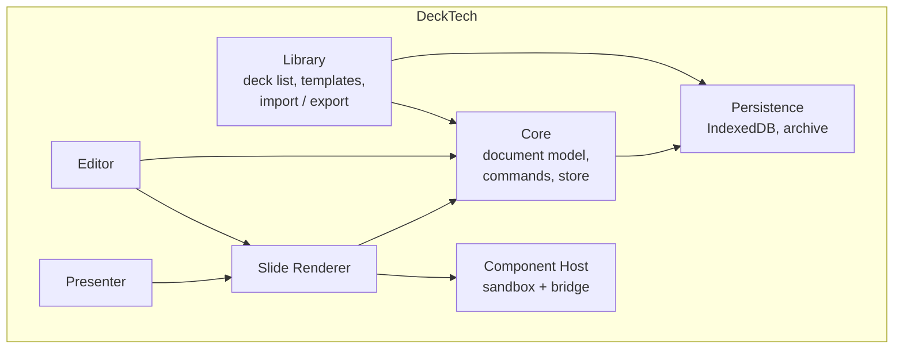
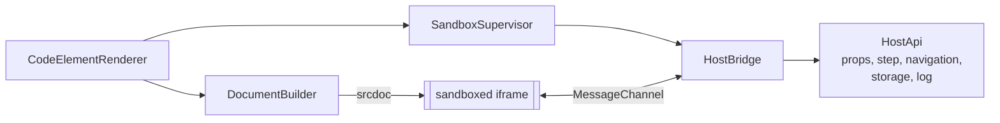

# 5. Building Block View

## 5.1 Level 1: whitebox overall system



| Building block | Responsibility |
|----------------|----------------|
| **Core** | The deck document model (TypeScript types + JSON schema), the command/undo system, the signal store, schema migrations. No UI. |
| **Persistence** | `DeckRepository` with an IndexedDB and an in-memory implementation; content-addressed asset store; rolling backup store; debounced autosave with a failure banner; `.deck` archive reader/writer (DT-16, not built yet). Implemented in `src/app/core/persistence/` (see 5.6). |
| **Renderer** | Turns a slide + theme into DOM. One component per element type. Handles stage scaling and step visibility. Used read-only by presenter, thumbnails and (with an overlay) by the editor. Implemented in `src/app/renderer/` (see 5.7). |
| **Component Host** | Creates and supervises sandboxed iframes, builds their document, implements the host side of the Component API, enforces the security policy. |
| **Editor** | Interactive layer over the renderer: selection, transform handles, snapping, slide sorter, toolbar, properties panel, shortcuts, code editor dialog. |
| **Presenter** | Fullscreen presentation, step engine, presenter view, notes, timer, cross-window sync. |
| **Library** | Home screen: list/search decks, create from template, rename, duplicate, delete; import/export and the component library come later. Implemented in `src/app/library/` (see 5.8). |

## 5.2 Level 2: Core

| Block | Responsibility |
|-------|----------------|
| `DeckModel` | Types: `Deck`, `Slide`, `Element`, `Theme`, `Layout`, `AssetRef`, `ComponentDef`, plus `SCHEMA_VERSION`, the stage constants, the id generator and the `createDeck` / `createSlide` / `createElement` factories. Implemented in `src/app/core/model/`. |
| `DeckStore` | Signal-based holder of the current deck (`@Service`). Exposes `deck()` (read-only), `currentSlide()`, `selection()`, `selectedElements()`, `canUndo()` / `canRedo()`. The deck changes only through `execute(command)`, `undo()` / `redo()` (which replay recorded patches) and `load(deck)` (opening a document; resets history; the caller runs `migrate` / `validateDeck` first). `undo()` / `redo()` apply the patch before moving the history entry, so a failing patch leaves deck and history unchanged. Selection and current slide are UI state. Implemented in `src/app/core/store/`. |
| `Command` | `{ name, coalesceKey?, do(deck) → { deck, patch, inverse } }`. `do` is pure; commands build the new deck with immutable updates and `resultOf(before, after)` derives the forward and inverse JSON patches by structural diff (referentially equal subtrees are skipped; arrays of `{ id }` objects are matched by id, so inserting or removing one slide or element is a single operation). Commands: `AddSlide`, `DeleteSlide`, `DuplicateSlide`, `ReorderSlides`, `SetNotes`, `AddElement`, `DeleteElements`, `MoveElements`, `ResizeElements`, `SetProps`, `ReorderElements`, `SetText`, `SetComponentSource`, `AddCodeElement`, plus `Batch(name, commands)`, which runs several commands in order as one undo step (duplicate, paste, rotating a selection) and throws, leaving the deck unchanged, if any of them does. Invalid targets or arguments throw `CommandError` and leave the deck untouched. |
| `History` | Bounded undo/redo stacks of `{ forward, inverse }` patch pairs (default 200 entries, configurable via `HISTORY_OPTIONS`). Commands with the same `coalesceKey` issued within 500 ms of the previous one (injectable `CLOCK`) are merged into one entry whose patches are re-diffed from the start of the burst, so its size follows the net change, not the number of commands; any other command, undo or redo ends the burst. `DeckStore.beginGesture(key)` (history `hold`) keeps merging that key regardless of the window until the returned release function is called, so a gesture is one entry however long the pointer rests. No-op commands record nothing. |
| `Migrations` | Registry of pure upgrade functions `vN → vN+1` (`MIGRATIONS`, keyed by the version upgraded from) and `migrate(raw): Result<MigrationOutcome, MigrationError>`, which runs the chain on a private clone and then `validateDeck`. Documents with a newer `schemaVersion` yield a `readOnly` outcome. `migrateStored(raw, sink)` additionally hands the untouched original to a `BackupSink` (implemented by persistence) before returning a migrated deck. Implemented in `src/app/core/migrations/`. See 8.1. |
| `Validation` | `validateDeck(unknown): Result<Deck, ValidationError[]>`, a hand-written runtime validator (no schema library) applied on import and load; guards against malformed or hostile files. See 8.1. |

### Document model (simplified)

```ts
interface Deck {
  schemaVersion: number;
  id: string;
  title: string;
  stage: Stage;               // logical stage size, default 1920x1080
  theme: Theme;               // colors, fonts, spacing tokens
  layouts: Layout[];          // master layouts with placeholders
  slides: Slide[];
  assets: Record<string, AssetRef>;   // id → blob key, mime, hash
  components: ComponentDef[]; // code component definitions used by this deck
}

interface Slide {
  id: string;
  layoutId: string;
  background?: Fill;
  elements: Element[];        // array order = z-order
  notes: string;
  transition?: Transition;
}

type Element = TextEl | ImageEl | ShapeEl | LineEl | TableEl | VideoEl | CodeEl;

interface ElementBase {
  id: string;
  x: number; y: number; w: number; h: number; rotation: number;  // stage units (1920x1080)
  locked?: boolean; hidden?: boolean;
  step?: number;              // appears at this step (0 = always visible)
}

interface CodeEl extends ElementBase {
  type: 'code';
  componentId: string;        // → Deck.components
  props: Record<string, unknown>;   // per-instance values for the component's declared props
}

interface ComponentDef {
  id: string;
  name: string;
  html: string; css: string; js: string;   // sources, edited in the code editor
  propSchema: PropSpec[];      // typed, drives the properties panel
  permissions: Permission[];   // e.g. 'network', 'storage' (requires user consent)
  files: string[];             // asset ids addressable by relative URL
  libs: string[];              // vendored library asset ids
}
```

Code is stored in `ComponentDef`, not in the element, so a component can be used on many slides and edited in one place; `CodeEl.props` carries per-instance data. A component can be "detached" into a unique copy.

The remaining element and supporting types, as implemented in `src/app/core/model/types.ts`:

```ts
interface TextEl  extends ElementBase { type: 'text';  text: string; font?: string; fontSize: number; color: Color; align: 'left'|'center'|'right'; }
interface ImageEl extends ElementBase { type: 'image'; assetId: string; alt: string; fit: 'cover'|'contain'|'stretch'; }
interface ShapeEl extends ElementBase { type: 'shape'; shape: 'rect'|'ellipse'|'triangle'; fill?: Fill; stroke?: Color; strokeWidth: number; }
interface LineEl  extends ElementBase { type: 'line';  stroke: Color; strokeWidth: number; }
interface TableEl extends ElementBase { type: 'table'; rows: string[][]; }
interface VideoEl extends ElementBase { type: 'video'; assetId: string; autoplay: boolean; loop: boolean; }

type Fill =
  | { kind: 'solid'; color: Color }
  | { kind: 'gradient'; angle: number; stops: { offset: number; color: Color }[] }
  | { kind: 'image'; assetId: string; fit: 'cover'|'contain'|'stretch' };

type Color = string | { token: string };   // literal CSS colour, or a key of Theme.colors
interface Stage { width: number; height: number; }   // width 1920 or height 1080
interface Transition { type: 'none'|'fade'|'slide'|'zoom'; durationMs: number; }
interface Theme { colors: Record<string,string>; fonts: Record<string,string>; typeScale: Record<string,number>; spacing: Record<string,number>; }
interface Layout { id: string; name: string; background?: Fill; placeholders: Placeholder[]; }
interface Placeholder { id: string; kind: 'title'|'body'|'image'|'footer'; x: number; y: number; w: number; h: number; }
interface AssetRef { blobKey: string; mime: string; hash: string; size: number; }
type Permission = 'network' | 'storage';
```

Colours are either a literal (`#rrggbb`, `rgb()`, `hsl()` or a keyword) or a `{ token }` reference into `Theme.colors`, and `TextEl.font` is a key into `Theme.fonts` (8.7). `TextEl.text` is plain text for now; it will change when ProseMirror rich text (ADR-004) is introduced. Element types are described declaratively in `ELEMENT_SCHEMAS` (`element-schema.ts`): per type, its fields and their kinds plus the defaults used by `createElement`. The validator and the factory both read it, so a new element type needs its interface in `types.ts` and one registry entry (quality scenario Q13). Ids are `<prefix>_<uuid>` strings (`dk`, `sl`, `el`, `cp`, `ly`, `ph`), generated with `crypto.randomUUID()` so they can be created offline and merged without coordination.

## 5.3 Level 2: Component Host



| Block | Responsibility |
|-------|----------------|
| `DocumentBuilder` | Assembles the iframe `srcdoc`: CSP meta tag, runtime script (`deck-runtime.js`), user HTML/CSS, user JS as a module, import map for vendored libs and asset URLs. |
| `SandboxSupervisor` | Lifecycle: create lazily, pause when off-screen, destroy; error and timeout capture; watchdog for unresponsive frames (heartbeat); pooling for thumbnails. |
| `HostBridge` | Message validation and routing on the dedicated `MessagePort`. Only whitelisted message types accepted; payloads structurally cloned and size-limited. |
| `HostApi` | Capability implementations: read props, subscribe to step changes, request navigation, per-deck key/value storage, console forwarding to the editor. |
| `ComponentLibrary` | Stores reusable `ComponentDef`s; built-in examples (counter, chart, live code demo, quiz, poll, embed). |
| `CodeEditorDialog` (lazy) | CodeMirror with HTML/CSS/JS tabs, live preview in a real instance, console panel, prop schema editor. |
| `TrustDialog` | Shown when importing a deck with code. Lists components, permissions, libraries and heuristic flags; per-component run/disable; records trust against the deck's content hash. |
| `CodeInspector` (lazy) | Read-only CodeMirror viewer used by the `TrustDialog`: tabs for HTML/CSS/JS/props/libs/assets, search, format-for-viewing, known-library hash check, and diff against the last trusted version. Never instantiates a frame. Shares the CodeMirror bundle with `CodeEditorDialog`. |

## 5.4 Level 2: Editor

Implemented so far (DT-07) in `src/app/editor/`: the shell, the canvas and its keyboard map. The slide sorter is a plain list of slide buttons, and the properties and notes panels are placeholders until their issues; the toolbar is the canvas toolbar below.

| Block | Responsibility |
|-------|----------------|
| `EditorShell` | `app-editor-shell`, the `deck/:id` route target (`id` input). Opens the deck through `AutosaveService.open(id)` (a newer route ignores a slower earlier load; a missing, invalid or read-only deck shows an alert instead of the canvas) and lays out sorter, canvas, properties and notes. The `h1` is "Editor" until the deck is open, so it never shows another deck's title; the last edits are flushed when the page is destroyed. |
| `Canvas` | `app-canvas`. Hosts `SlideRenderer` in `edit` mode and an interaction overlay: a layer of divs in stage units (scaled by the zoom, handle sizes and lines kept constant on screen through `--inv`) with one transparent hit target per element, in z-order, the selection frame with handles, snapping guides and the marquee. The overlay owns all pointer input, so iframes never swallow it. In "interact" mode the hit target of the one selected code element lets the pointer through; the mode ends when the selection changes. |
| `EditorActions` | `@Service` with every non-pointer action: select all / next / previous, deselect, nudge, resize, rotate by a step, align, distribute, delete, duplicate, copy, paste, z-order, undo, redo. Each is one command (one undo step) and announces its result through `LiveAnnouncer`. Toolbar and shortcuts both call it. |
| `Shortcuts` | `CANVAS_SHORTCUTS`: the keyboard map as data (key, modifiers, description, action), looked up by `findShortcut`; the canvas renders it as the "Keyboard shortcuts" help. |
| `geometry`, `snapping`, `viewport` | Pure functions, in stage units: rotated corners and bounds, `resizeBox`, `scaleInto`, `angleTowards`, align / distribute; snap targets and `snapMove`; fit / zoom-at / pan / `toStage`. |
| `SlideSorter`, `Toolbar` / `InsertMenu`, `PropertiesPanel`, `NotesPane` | Not built yet (later issues). |

### Canvas behaviour

- **Coordinates.** The viewport is `{ zoom, panX, panY }` (UI state, not in history): `zoom` is the factor `k` of 5.7, so a pointer position is turned into stage units with `(client - area origin - pan) / zoom`. "Fit" is the default and follows the area size; 100% is zoom 1; the range is 10% to 800%. Ctrl+wheel zooms around the pointer, the plain wheel, middle-button drag or Space+drag pan, and the arrow keys pan while nothing is selected. Panning keeps at least 64 px of the slide in view.
- **Selection.** Click selects, Shift+click toggles, a press on empty space clears and starts a marquee (Shift keeps the existing selection). The marquee selects every element whose rotated bounds *intersect* it. Pressing one of several selected elements without dragging narrows the selection to it on release.
- **Move.** A press becomes a drag after 3 screen pixels. The moving bounds snap (6 screen pixels, so `6 / zoom` stage units) to the slide edges and centre and to the edges and centre of every other visible element; Alt turns snapping off. The snap lines are built once per gesture. Each pointer move issues `MoveElements` with the step since the previous one.
- **Resize.** Eight handles on a single element (in the element's own, rotated frame; the opposite edge stays put on the stage) and on a group of unrotated elements (scaled as a block with `scaleInto`; a group with a rotated member gets no handles because scaling would shear it). Shift keeps the ratio, nothing gets smaller than 1 unit, and a resize never flips. Unrotated boxes snap the dragged edges. Each move issues `ResizeElements` with absolute geometry.
- **Rotate.** A handle above a single element; the angle follows the pointer, Shift snaps to 15 degrees. It issues `SetProps { rotation }`.
- **One undo step per gesture.** Every gesture has its own `coalesceKey` and holds it open with `DeckStore.beginGesture(key)` until the pointer is released, so a pause longer than the 500 ms window still does not split it. Escape during a gesture undoes it (only if it changed the deck; a press that never moved has nothing to undo).
- **Locked elements** can be selected, copied, duplicated and reordered but not moved, resized, rotated, aligned or deleted from the editor; they show a dashed frame and no handles.
- **Keyboard** (all of it is listed in the "Keyboard shortcuts" disclosure under the canvas): Tab / Shift+Tab select the next / previous element and, past the last / first one, are left to the browser so the canvas is not a keyboard trap; arrows nudge 1 unit (Shift 10); Ctrl+arrows resize from the top-left corner; Alt+Left / Right rotate 1 degree (Shift 15); Delete; Ctrl+A / D / C / V / Z / Shift+Z / Y; `[` and `]` one step in z-order, Ctrl+`[` / `]` to back / front; `+`, `-`, Ctrl+0, Ctrl+1 for zoom; Enter toggles interact mode; Escape clears the selection. Align, distribute, z-order, duplicate, delete, undo / redo, zoom and interact mode are also buttons in the toolbar; buttons that cannot act use `aria-disabled`, not `disabled` (8.8).
- **Announcements.** Selection changes, deletes, pastes, alignments and cancelled gestures are spoken through the live region ("Text “Hello”, 2 of 5, selected", "3 elements selected"). Marquee selection is announced when the marquee ends, not for every intermediate state.
- **Copy and paste** use an in-app clipboard (a structured clone, tied to the deck id, so nothing is pasted into another deck where a code element could dangle). Duplicate and each paste shift the copies by 20 units further, give them fresh ids, add them to the current slide as one `Batch` and select them.

## 5.5 Level 2: Presenter

| Block | Responsibility |
|-------|----------------|
| `PresentationView` | Fullscreen stage; navigation by keyboard, click, touch, clicker; slide transitions. |
| `StepEngine` | Computes steps per slide from element `step` values and from steps requested by code components (e.g. "this component has 4 internal steps"); next/prev consume component steps before changing slide. |
| `PresenterView` | Second window: current slide, next slide preview, notes, timer, step indicator. Synchronised using `BroadcastChannel`. |
| `Preloader` | Instantiates the next slide's code components ahead of time. |

## 5.6 Level 2: Persistence

All in `src/app/core/persistence/`; the dependency rule of 4.4 holds (it uses only `model`, `migrations` and `store`).

| Block | Responsibility |
|-------|----------------|
| `DeckRepository` | Abstract class (also the DI token): `list()`, `load(id)`, `save(deck, expectedRevision)`, `delete(id)`, `putAsset(blob)`, `getAsset(id)`, plus `listUnexported()` / `markExported(id, revision?)` (export reminders, 7.4; with a revision the mark stays if a newer save happened after the export) and `listBackups(deckId)`. No method rejects: every one returns `Result<T, PersistenceError>` (`not-found`, `conflict`, `read-only`, `invalid`, `quota`, `storage`); `load` additionally carries the `MigrationError`s of `migrateStored`. |
| `IndexedDbDeckRepository` | The production implementation on `idb`; also the `BackupSink`. Object stores: `decks` (`{ id, deck }`), `assets` (`{ hash, mime, data }`), `components` (reserved for the component library, a later issue; created now so it needs no schema upgrade), `meta` (small per-deck records `summary:<id>` and `unexported:<id>`) and `backups` (pre-migration copies, index `byDeck`). |
| `InMemoryDeckRepository` | Same contract on `Map`s (structured clones, like IndexedDB), for tests and as the reference for the contract suite that runs against both implementations. |
| `AutosaveService` | `@Service` that keeps the open deck in sync with the repository: `create(deck)` and `open(id)` (both save the current deck first and refuse to replace it while that fails, unless forced), `flush()`, `status` (`saved` / `saving` / `error`), `error`, `persisted`, `requestPersistence()`, `exportDeck()`. See 8.5. |
| `PersistenceBanner` | `app-persistence-banner`: `role="alert"` notice inside a labelled `section` landmark, shown while `status() === 'error'`, with "Try again" and (when an export handler is provided) "Download .deck". Lives in `core` because the issue scoped it there; move it to `shared/` if a second consumer needs it. |
| `DECK_EXPORT_HANDLER` | Typed hook (`(deck) => void \| Promise<void>`, default `null`) through which the `.deck` writer of DT-16 plugs into the banner. |
| `provideDeckPersistence()` | Environment providers for the app: the IndexedDB repository and an initializer that requests persistent storage. |

## 5.7 Level 2: Renderer

All in `src/app/renderer/`; it uses only `core` (4.4).

| Block | Responsibility |
|-------|----------------|
| `SlideRenderer` | `app-slide-renderer`. Inputs `slide`, `theme`, `mode` (`edit` / `present` / `thumbnail`, default `present`), `step` (default: all revealed) and `stage` (default 1920x1080; pass `deck.stage`). Draws the slide on a stage of the logical size and scales it with `transform: scale(k)`, `k = containerWidth / stageWidth`, where the width comes from a `ResizeObserver` on the host (exposed as `scale()`; 0 until the host has a width). The host takes the width of its container and keeps the stage aspect ratio, so the caller sizes it. Theme tokens are set as custom properties on the stage; the slide background (or the theme `background` colour) is drawn by the stage. |
| `ElementView` and `TextElement`, `ImageElement`, `ShapeElement`, `LineElement` | One component per element type. The abstract base takes the slide's element map, the element id and the theme, selects its element in a `computed` and sets position, size and rotation on its host. The map changes with every slide change but an untouched element keeps its identity, so only the element whose props changed re-renders (the `RENDER_PROBE` token lets tests count this). Table, video and code elements are not rendered yet. |
| `isElementShown` | Visibility rule. `present` and `thumbnail` leave hidden elements and elements with `step` above the current step out of the DOM, so they are also out of the accessibility tree. `edit` keeps every element so it can be selected; hidden ones get a `ghost` class (dimmed) and `aria-hidden`. |
| `theme.ts` | `themeVars` (`--deck-color-*`, `--deck-font-*`, `--deck-type-*`, `--deck-space-*`), `resolveColor`, `resolveFont`, `fillStyle`. Commands do not check structured values (8.4), so everything that reaches a style declaration is re-checked here: colours must match the validator's literal pattern or be an existing token, unsafe keys and font values are skipped, and anything else is dropped. |
| `AssetUrls` | `@Service` turning an asset id into an object URL signal through `DeckRepository.getAsset` (ids are content hashes, 8.5; other ids are never looked up). A failed or rejected read is forgotten so the next read retries; successful URLs are kept (and revoked) until the service is destroyed, so there is no eviction for assets a deck stops using. Without a repository the image shows a placeholder (labelled by `alt`, hidden from assistive technology when `alt` is empty). |
| `parseText` | Splits plain element text into paragraphs and bullet lists; text with the theme `heading` font becomes one `h2`, however many lines. To be replaced by the ProseMirror JSON renderer (ADR-004). |

Decisions where the model left room: images are plain `img` elements, not `NgOptimizedImage`, because their sources are object URLs; the triangle shape is clipped and so has no stroke; there is no rounded rectangle (not in the model). Thumbnails are `aria-hidden` and `inert`.

## 5.8 Level 2: App shell, Library and Shared

| Block | Responsibility |
|-------|----------------|
| App shell (`app.ts`, `app.html`, `app.routes.ts`) | A skip link, the `PersistenceBanner`, a `main#main-content` landmark (`tabindex="-1"`; after every navigation except the first the shell focuses the new page's `h1`, else the landmark) around the `router-outlet`, and the live region. Routes: `''` library, `dev/stress` (only in dev mode, see 10.3), `deck/:id` editor, `deck/:id/present` presenter, `deck/:id/presenter-view` presenter view, anything else redirects to `''`. All are lazy; `withComponentInputBinding()` hands `:id` to the page as an `id` input. The editor route shows `EditorShell` (5.4); until the presenter exists its two routes show a placeholder page (`PresenterPage`, `PresenterViewPage`) with a link back to the library. |
| `DeckLibrary` | `@Service` behind the home screen. `decks()` (summaries from `DeckRepository.list()`, newest first), `status()` (`loading` / `ready` / `error`), `busy()`, `templates`, and `refresh`, `createBlank`, `createFromTemplate`, `rename`, `duplicate`, `remove`, each returning a `Result<_, { message }>` that is fit to show. Operations are queued and run one at a time (`busy()` turns on synchronously, so buttons disable before the first one starts). Storage is written first and the list refreshed only after it accepted the change, so a failure leaves the list as it was; a failed refresh after a successful write does not turn the write into an error. `rename` and `duplicate` load the deck through the repository (so a stored older version is migrated and backed up as usual) and refuse a read-only deck from a newer version; `remove` allows it. `rename` saves with the loaded revision, so a change from another tab comes back as a `conflict` message. A duplicate changes only the deck id (other ids are scoped to their deck and assets are shared by hash) and is titled `Copy of <title>`. Titles are trimmed, non-empty and at most 200 characters (`checkTitle`). |
| Templates (`templates.ts`) | `BUILT_IN_TEMPLATES`: plain deck JSON (title and bullets, sections, big statement). `instantiateTemplate` clones the JSON, gives it a fresh deck id and runs `validateDeck`, so a malformed template is an error rather than a stored deck. |
| `LibraryPage` | `app-library-page`. Search (case-insensitive substring of the title), create actions, and the list: a thumbnail placeholder (the title's initial, `aria-hidden`), the title as a link to the editor, the modified date in a `time` element, and Rename / Duplicate / Delete buttons whose accessible names include the deck title. Rename is an inline labelled form; delete asks in an `alertdialog` that traps focus and closes on Escape; on failure it stays open with the reason, and on Cancel focus goes back to the row's Delete button. Buttons are not `disabled` while an operation runs (that would drop keyboard focus); they get `aria-disabled` and the handlers ignore the click. After each action focus moves to an element that exists (the heading when the target row is gone) and successes are announced; failures appear in a `role="alert"` banner, which is announced by itself. Creating a deck navigates to its editor route. |
| `shared/` | `LiveAnnouncer` + `app-live-region` (one polite `role="status"` region; the message is cleared first so repeated text is announced again, and a newer announcement replaces a pending one), `FocusTrap` (`appFocusTrap`: initial focus on `[data-autofocus]` or the first control, Tab wrap, focus restored on destroy) and `app-skip-link`. `shared` depends on nothing. |

Decisions where the issue left room: the list is not virtualised by a scroller. It draws 60 decks and adds 60 more on "Show more" (a real button, keyboard operable, reset by a new search), and rows use `content-visibility: auto`, so a long list opens fast without a windowing library that would hide rows from keyboard and assistive technology. Thumbnails are placeholders because `library` may not import `renderer` (4.4); rendering real slide thumbnails here needs the rule to change or a thumbnail provider in `shared`, and is recorded in 11.2. The library reads and writes through `DeckRepository` directly and never touches `DeckStore` or `AutosaveService`.
