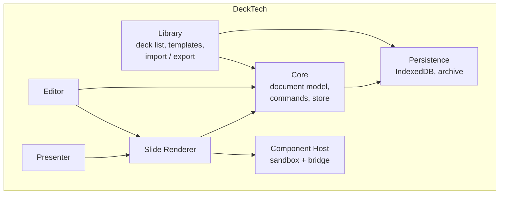
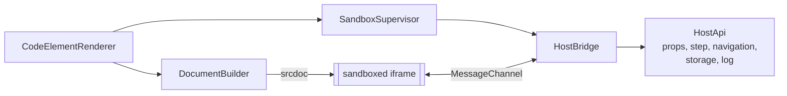

# 5. Building Block View

## 5.1 Level 1: whitebox overall system



| Building block | Responsibility |
|----------------|----------------|
| **Core** | The deck document model (TypeScript types + JSON schema), the command/undo system, the signal store, schema migrations. No UI. |
| **Persistence** | `DeckRepository` interface with an IndexedDB implementation; asset store; `.deck` archive reader/writer; autosave. |
| **Renderer** | Turns a slide + theme into DOM. One component per element type. Handles stage scaling and step visibility. Used read-only by presenter, thumbnails and (with an overlay) by the editor. |
| **Component Host** | Creates and supervises sandboxed iframes, builds their document, implements the host side of the Component API, enforces the security policy. |
| **Editor** | Interactive layer over the renderer: selection, transform handles, snapping, slide sorter, toolbar, properties panel, shortcuts, code editor dialog. |
| **Presenter** | Fullscreen presentation, step engine, presenter view, notes, timer, cross-window sync. |
| **Library** | Home screen: list/search decks, create from template, import/export, component library. |

## 5.2 Level 2: Core

| Block | Responsibility |
|-------|----------------|
| `DeckModel` | Types: `Deck`, `Slide`, `Element`, `Theme`, `Layout`, `Asset`, `ComponentDef`. |
| `DeckStore` | Signal-based holder of the current deck. Exposes `deck()`, `currentSlide()`, `selection()` and computed views. Mutation only via `execute(command)`. |
| `Command` | `{ do(deck) → patch, undo }`. Examples: `AddSlide`, `MoveElements`, `SetProps`, `ReorderSlides`. Consecutive similar commands (dragging) are coalesced. |
| `History` | Undo/redo stacks of inverse patches; bounded size. |
| `Migrations` | Upgrade functions `vN → vN+1` applied on load/import. |
| `Validation` | JSON-schema validation on import; guards against malformed or hostile files. |

### Document model (simplified)

```ts
interface Deck {
  schemaVersion: number;
  id: string;
  title: string;
  theme: Theme;               // colors, fonts, spacing tokens
  layouts: Layout[];          // master layouts with placeholders
  slides: Slide[];
  assets: Record<string, AssetRef>;   // id → blob key, mime, hash
  components: ComponentDef[]; // code component definitions used by this deck
}

interface Slide {
  id: string;
  layoutId: string;
  background?: Fill;
  elements: Element[];        // array order = z-order
  notes: string;
  transition?: Transition;
}

type Element = TextEl | ImageEl | ShapeEl | LineEl | TableEl | VideoEl | CodeEl;

interface ElementBase {
  id: string;
  x: number; y: number; w: number; h: number; rotation: number;  // stage units (1920x1080)
  locked?: boolean; hidden?: boolean;
  step?: number;              // appears at this step (0 = always visible)
}

interface CodeEl extends ElementBase {
  type: 'code';
  componentId: string;        // → Deck.components
  props: Record<string, unknown>;   // per-instance values for the component's declared props
}

interface ComponentDef {
  id: string;
  name: string;
  html: string; css: string; js: string;   // sources, edited in the code editor
  propSchema: PropSpec[];      // typed, drives the properties panel
  permissions: Permission[];   // e.g. 'network', 'storage' (requires user consent)
  files: string[];             // asset ids addressable by relative URL
  libs: string[];              // vendored library asset ids
}
```

Code is stored in `ComponentDef`, not in the element, so a component can be used on many slides and edited in one place; `CodeEl.props` carries per-instance data. A component can be "detached" into a unique copy.

## 5.3 Level 2: Component Host



| Block | Responsibility |
|-------|----------------|
| `DocumentBuilder` | Assembles the iframe `srcdoc`: CSP meta tag, runtime script (`deck-runtime.js`), user HTML/CSS, user JS as a module, import map for vendored libs and asset URLs. |
| `SandboxSupervisor` | Lifecycle: create lazily, pause when off-screen, destroy; error and timeout capture; watchdog for unresponsive frames (heartbeat); pooling for thumbnails. |
| `HostBridge` | Message validation and routing on the dedicated `MessagePort`. Only whitelisted message types accepted; payloads structurally cloned and size-limited. |
| `HostApi` | Capability implementations: read props, subscribe to step changes, request navigation, per-deck key/value storage, console forwarding to the editor. |
| `ComponentLibrary` | Stores reusable `ComponentDef`s; built-in examples (counter, chart, live code demo, quiz, poll, embed). |
| `CodeEditorDialog` (lazy) | CodeMirror with HTML/CSS/JS tabs, live preview in a real instance, console panel, prop schema editor. |
| `TrustDialog` | Shown when importing a deck with code. Lists components, permissions, libraries and heuristic flags; per-component run/disable; records trust against the deck's content hash. |
| `CodeInspector` (lazy) | Read-only CodeMirror viewer used by the `TrustDialog`: tabs for HTML/CSS/JS/props/libs/assets, search, format-for-viewing, known-library hash check, and diff against the last trusted version. Never instantiates a frame. Shares the CodeMirror bundle with `CodeEditorDialog`. |

## 5.4 Level 2: Editor

| Block | Responsibility |
|-------|----------------|
| `EditorShell` | Layout of panels, routing, keyboard shortcut registry. |
| `SlideSorter` | Vertical thumbnail list; drag-and-drop reorder, add, duplicate, delete, sections. |
| `Canvas` | Hosts the renderer and an interaction overlay. Selection box, resize/rotate handles, snapping guides, marquee select, zoom/pan. Pointer events are captured by the overlay, so iframes do not swallow input while editing; in "interact" mode the overlay is disabled for the selected code element. |
| `Toolbar` / `InsertMenu` | Insert text, image, shape, code component; quick-insert via `/`. |
| `PropertiesPanel` | Contextual, schema-driven: common geometry/style, text formatting, and a generated form for each code component's `propSchema` (built with signal forms). |
| `NotesPane` | Speaker notes for the current slide. |
| `Shortcuts` | Central registry; discoverable help overlay. |

## 5.5 Level 2: Presenter

| Block | Responsibility |
|-------|----------------|
| `PresentationView` | Fullscreen stage; navigation by keyboard, click, touch, clicker; slide transitions. |
| `StepEngine` | Computes steps per slide from element `step` values and from steps requested by code components (e.g. "this component has 4 internal steps"); next/prev consume component steps before changing slide. |
| `PresenterView` | Second window: current slide, next slide preview, notes, timer, step indicator. Synchronised using `BroadcastChannel`. |
| `Preloader` | Instantiates the next slide's code components ahead of time. |
