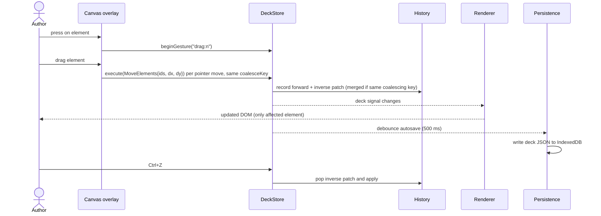
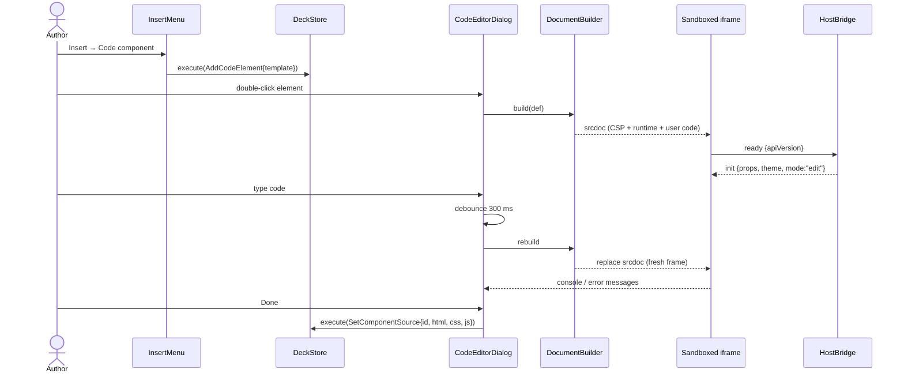
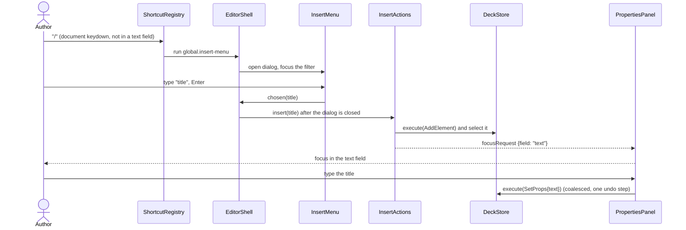
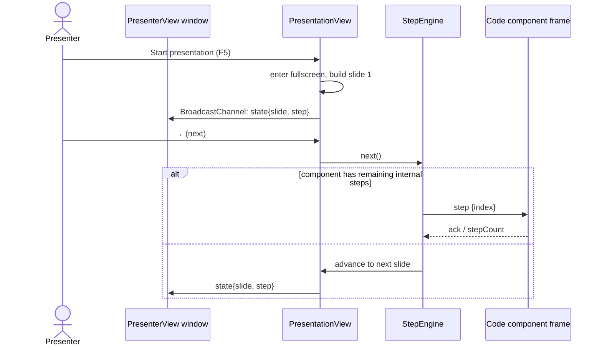
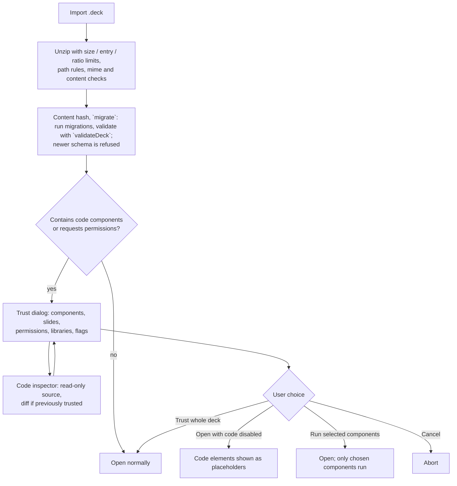

# 6. Runtime View

## 6.1 Editing a slide (command flow)

Only changed elements re-render because each element renderer reads a `computed` that selects its own element by id. A drag on a 100-element slide therefore re-renders only the dragged element per pointer move (a canvas test counts this with `RENDER_PROBE`), and its history entry stays one patch pair of the net change however long the gesture is. On pointer release the canvas ends the gesture hold; Escape instead undoes the whole gesture.

`AutosaveService` watches `DeckStore.deck()` but only for the deck handed to it by `create(deck)` or `open(id)`: opening a deck never rewrites it (except right after a migration, so the upgrade is stored), and a deck swapped into the store behind its back is ignored. Each change restarts a 500 ms timer; a continuous gesture is written at the latest after 5 s (`maxWaitMs`). Writes are serialised and each one passes the revision of the last stored copy, so a second tab that saved in between turns the write into a `conflict` instead of an overwrite (8.5). `flush()` writes immediately and is awaited before opening another deck, import and other risky operations.

## 6.2 Creating and editing a code component

Text elements follow the same gesture, with a different editor: clicking the selected text element (or Enter, or typing) starts the in-place ProseMirror editor, which loads its own chunk on first use. Typing changes nothing in the deck; leaving the text (blur, Escape, selecting something else) commits one `SetText` if the content changed, so the whole edit is one undo step (5.4, "Rich text editing").

`Insert → Code component` is `InsertActions.insert('code')`: it adds a starter `ComponentDef` with a fresh id and a code element in one `AddCodeElement` command and selects the element; the code editor opens on the selected element (Ctrl+Enter, double-click, "Edit code…") as `CodeEditorDialog`, described in 5.3. The `SetComponentSource{id, html, css, js}` of the diagram is one part of the `Batch` that "Done" executes (it also carries the name, prop schema, permissions and libraries of the draft), so all of it is one undo step.

Reloading the frame on each change (rather than hot-patching) keeps semantics identical to presentation. Component state that the author wants to keep across reloads can use `deck.state` (see 8.3). In the diagram the "ready" / "init" pair is the handshake of 5.3: the frame posts `ready { apiVersion }`, the supervisor answers with a transferred `MessagePort`, and `init` (props, theme, mode, size, saved state, libraries) goes over that port, which is the only channel from then on.

## 6.2a Quick insert from the keyboard

The dialog is closed before the element is inserted, so the focus trap has already given focus back and the panel's focus request is the last word. A picture takes the same path up to `pickImage()`, then `insertImage(file)` once the file chooser returns.

## 6.3 Presenting

The `Preloader` creates the next slide's frames while the current slide is shown, so advancing is instant. Frames of slides more than one away are destroyed.

Built (DT-14): `StepEngine`, the `Preloader` rule and `PresentationView` as in 5.5 ("Presentation behaviour"). In the diagram `next()` is answered by the position alone: the view writes the component's internal step to `CodeHostEvents.stepIndexes` and the frame is told through `deck.onStep`; there is no acknowledgement round trip, the component's `deck.steps(n)` count is what the engine plans with. Built (DT-15): the `PresenterView` window. The `state` in the diagram carries `slide`, `step`, the step count, the slide count and the timer; the reverse direction is `command{next|prev|goTo}` and `timer{start|pause|reset}`, applied by the presentation window, and `hello` (a reopened view asks for a `state`). See 5.5 "Presenter view and cross-window sync".

## 6.4 Opening a foreign deck

As built (DT-16), steps A to C are `DeckArchive.importFile` (8.2 "As built (DT-16)"): the whole file is verified in memory first, and only a file that passed is stored, as a new deck that never replaces one with the same id. The result is marked `untrusted` and carries `hasCode`, the content `hash` and the file's `sourceId`. Built (DT-17), D to J: for a deck with components `importBytes` first writes a pending `TrustRecord`; the library page tells the user the code stays switched off and links to the deck; when the editor opens it, `TrustStore` answers "no" for every component, which gets a placeholder and no frame, and the trust dialog opens by itself (5.3, "Trust dialog and code inspector behaviour"). The choices store one decision (`Run selected components`, `Trust whole deck`, `Open with code disabled`); `Cancel` stores nothing and the deck stays switched off. The presenter does not ask: it shows the placeholders for whatever is undecided.

Locally authored decks are trusted by default (they have no trust record); decks imported from files are untrusted until the user decides. Trust is recorded per deck id and, for each component, the hash of its definition (see [ADR-008](../ADRs/ADR-008-trust-prompt-for-imported-decks.md)): a component whose definition changes, or that is added later, is undecided again.

The inspector shows source as text only. No frame is created for an untrusted component, so reading the code never runs it. If a deck is imported again, the new copy (it gets a new id while the old one exists) is pending and carries the sources the user trusted for the same file deck id (`previous`); the inspector opens on a per-component diff against them and the dialog marks each component *Changed*, *New* or *Unchanged*. An unchanged re-import asks again too: nothing is trusted on the strength of an earlier answer for a different copy. If the old deck was deleted, there is nothing to compare with.

## 6.5 Error handling at runtime

- A component that throws or hangs shows an error overlay (in edit mode) or is replaced by a neutral placeholder (in presentation mode) so one broken component never stops the talk.
- Frame heartbeat missing for 5 s → the supervisor marks it unresponsive; the author can reload or skip it. Built (DT-11): the runtime beats every second; a frame that never says `ready` within 5 s, navigates away, floods or sends garbage is `failed` and destroyed, a silent one is `unresponsive` and recovers if it beats again; the editor shows the reason with "Reload component" and "Skip component", presenting destroys the frame and shows "This component is unavailable." (so does a component that throws), and the slide is never blocked (Q8). Reasons also go to `HostConsole` and, tagged by component id, to `ErrorService` (8.9). Built (DT-12): frames beyond one slide from the shown one, and editor frames scrolled out of view, are destroyed and made again on return (5.3, "Frame lifecycle").
- Autosave failure (quota, IndexedDB error, conflict with another tab) sets `AutosaveService.status` to `error` and shows the persistent `PersistenceBanner` (`role="alert"`) with "Try again" and, an immediate `.deck` download (`DECK_EXPORT_HANDLER`, provided by `provideDeckArchive()`; it exports the deck as it is in memory, including the changes that could not be saved). The failed deck stays pending: nothing is marked saved, the next edit or "Try again" retries, and `open(id)` refuses to leave a deck whose changes could not be saved unless forced.
