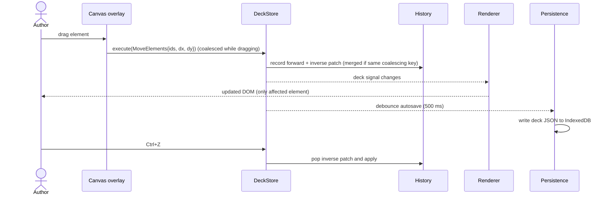
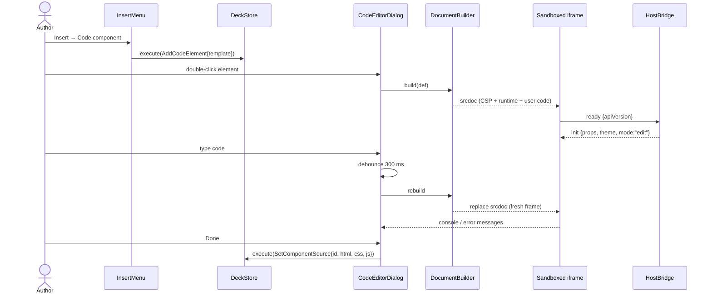
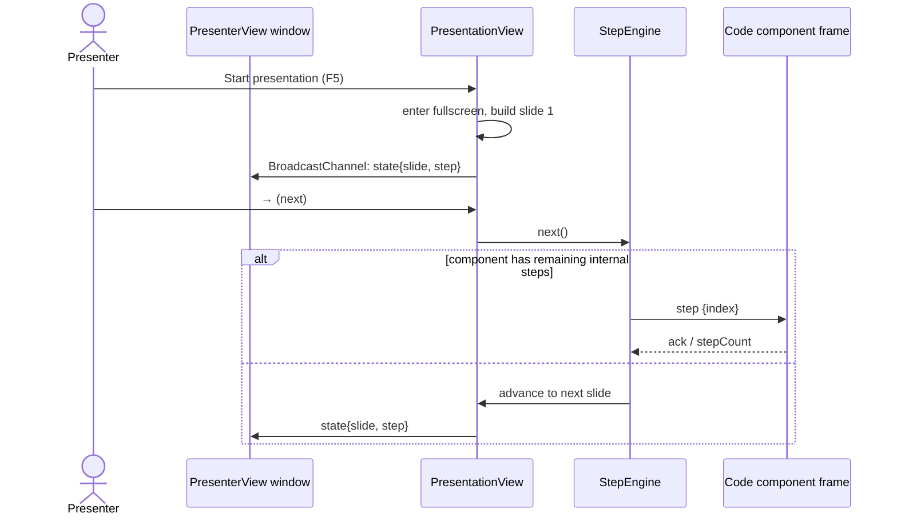
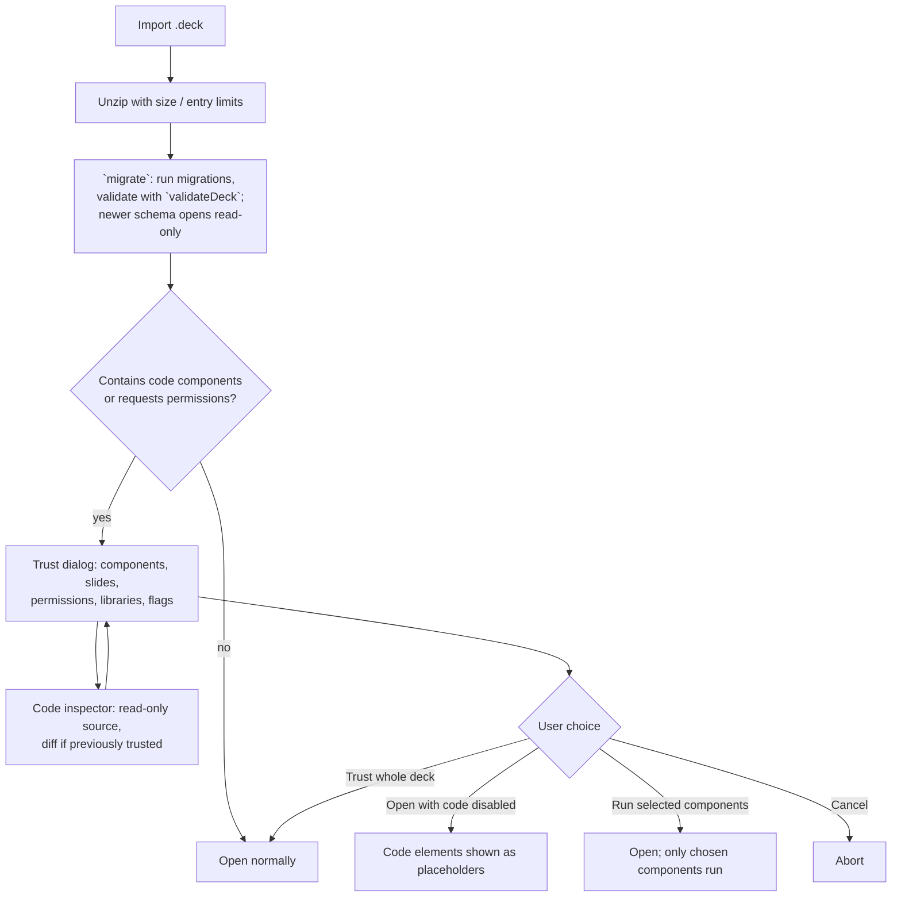

# 6. Runtime View

## 6.1 Editing a slide (command flow)

Only changed elements re-render because each element renderer reads a `computed` that selects its own element by id.

## 6.2 Creating and editing a code component

Reloading the frame on each change (rather than hot-patching) keeps semantics identical to presentation. Component state that the author wants to keep across reloads can use `deck.state` (see 8.3).

## 6.3 Presenting

The `Preloader` creates the next slide's frames while the current slide is shown, so advancing is instant. Frames of slides more than one away are destroyed.

## 6.4 Opening a foreign deck

Locally authored decks are trusted by default; decks imported from files are untrusted until the user decides. Trust is recorded per deck id + content hash (see [ADR-008](../ADRs/ADR-008-trust-prompt-for-imported-decks.md)).

The inspector shows source as text only. No frame is created for an untrusted component, so reading the code never runs it. If a previously trusted deck is re-imported with a different hash, the inspector opens on a per-component diff against the last trusted version.

## 6.5 Error handling at runtime

- A component that throws or hangs shows an error overlay (in edit mode) or is replaced by a neutral placeholder (in presentation mode) so one broken component never stops the talk.
- Frame heartbeat missing for 5 s → the supervisor marks it unresponsive; the author can reload or skip it.
- Autosave failure (quota, IndexedDB error) shows a persistent banner and offers immediate `.deck` download.
