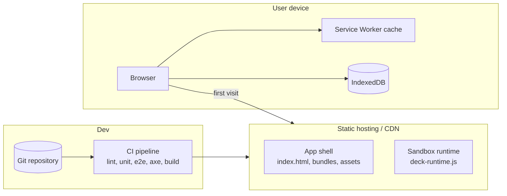

# 7. Deployment View

## 7.1 Infrastructure level 1

DeckTech is a static single-page application. There is no application server and no database server.

| Element | Description |
|---------|-------------|
| Static hosting | Any static host (GitHub Pages, Netlify, S3 + CDN, an intranet web server). Must serve the app over HTTPS (required for service workers and several browser APIs) and set the security headers listed below. |
| Service Worker | Precaches the application shell, lazy chunks (CodeMirror, ProseMirror), fonts, and the sandbox runtime. After the first load the app works fully offline. |
| IndexedDB | All user data lives here on the device. |
| Desktop wrapper (optional) | The same build can be wrapped (e.g. Tauri/Electron) later for native file access. Not required. |

## 7.2 Required HTTP headers

| Header | Value (summary) | Purpose |
|--------|-----------------|---------|
| `Content-Security-Policy` | `default-src 'self'; frame-src 'self' blob: data:; img-src 'self' blob: data:; style-src 'self' 'unsafe-inline'; ...` | Hardens the host app. Sandbox frames carry their own, stricter CSP. |
| `Cross-Origin-Opener-Policy` | `same-origin` | Isolates the host browsing context group (the presenter view is opened with `noopener`: the two windows sync over `BroadcastChannel`, which needs no opener and works under this policy). |
| `Referrer-Policy` | `no-referrer` | Do not leak deck URLs. |
| `X-Content-Type-Options` | `nosniff` | Standard. |

## 7.3 Environments

| Environment | Purpose |
|-------------|---------|
| Local dev | `ng serve`, service worker disabled. |
| Preview | Built per pull request on the static host, used for e2e and manual checks. |
| Production | Tagged release. Versioned assets with content hashes; service worker updates in the background and prompts the user to reload, never mid-presentation. |

## 7.4 Data location and backup

User data is only on the user's device. Backup is by exporting `.deck` files. The app requests persistent storage (`navigator.storage.persist()`) at startup to reduce the risk of eviction, and records per deck when it was first changed after its last export (`DeckRepository.listUnexported()`, 8.5); the periodic reminder built on that comes with the library.
