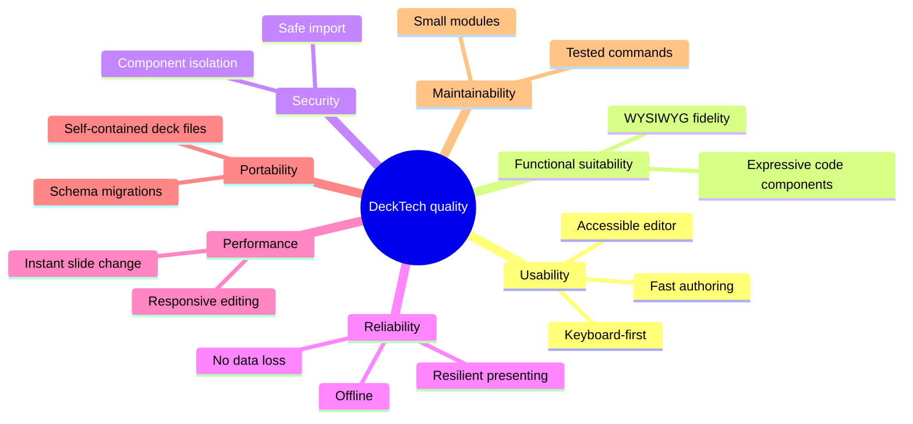

# 10. Quality Requirements

## 10.1 Quality tree

## 10.2 Quality scenarios

| ID | Quality | Scenario | Target |
|----|---------|----------|--------|
| Q1 | Usability | A new user adds a slide with title and bullet list from a blank deck. | < 30 s, without reading docs. |
| Q2 | Usability | An author adds a slide with a titled image using only the keyboard. | Possible with documented shortcuts; AXE clean. |
| Q3 | Expressiveness | A developer builds an interactive chart with a vendored library as a code component. | Works offline; no host changes required. |
| Q4 | Security | A malicious imported component tries to read `parent.document`, IndexedDB, or send data to an external server. | All attempts fail; user was prompted before code ran. |
| Q4a | Security / Usability | A developer opens a colleague's deck and wants to review its code before running it. | Every component's HTML, CSS, JS and libraries are readable in the trust dialog in ≤ 2 clicks, without any component code executing. Re-importing a changed deck shows a diff. |
| Q5 | Security | A crafted `.deck` ZIP contains path traversal or a decompression bomb. | Import rejected with a message; app unaffected. |
| Q6 | Reliability | The network drops (or never existed) during a talk. | Everything works; no network requests are made by the host. |
| Q7 | Reliability | The browser crashes while editing. | At most the last ~1 s of edits lost on reload. |
| Q8 | Reliability | A code component throws or hangs when presenting. | Slide still advances; component shows placeholder within 5 s. |
| Q9 | Performance | Drag an element on a slide with 100 elements and 3 code components. | ≥ 55 fps on a mid-range laptop. |
| Q10 | Performance | Advance to the next slide containing code components. | Visible within 100 ms (preloaded). |
| Q11 | Performance | Open a 200-slide deck. | List shown < 1 s; thumbnails lazily rendered. |
| Q12 | Portability | Open a deck exported by an older app version. | Migrated automatically, no data loss. |
| Q13 | Maintainability | Add a new built-in element type. | Touches one renderer, one editor-panel section, one schema entry; no changes in core store or history. |
