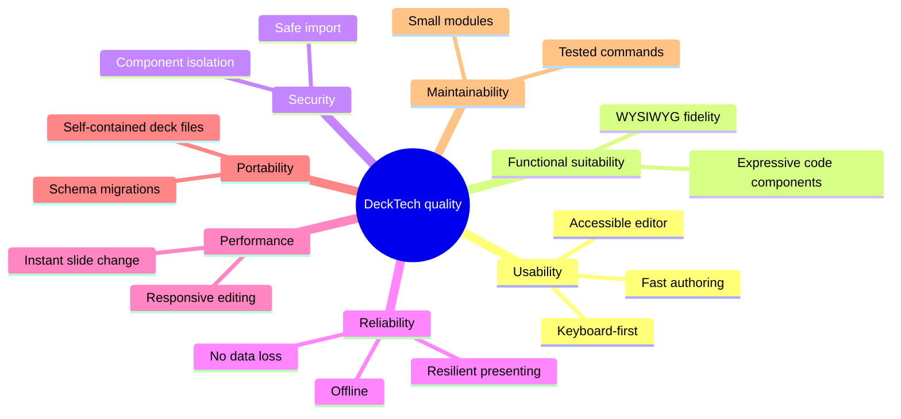

# 10. Quality Requirements

## 10.1 Quality tree

## 10.2 Quality scenarios

| ID | Quality | Scenario | Target |
|----|---------|----------|--------|
| Q1 | Usability | A new user adds a slide with title and bullet list from a blank deck. | < 30 s, without reading docs. |
| Q2 | Usability | An author adds a slide with a titled image using only the keyboard. | Possible with documented shortcuts; AXE clean. |
| Q3 | Expressiveness | A developer builds an interactive chart with a vendored library as a code component. | Works offline; no host changes required. |
| Q4 | Security | A malicious imported component tries to read `parent.document`, IndexedDB, or send data to an external server. | All attempts fail; user was prompted before code ran. |
| Q4a | Security / Usability | A developer opens a colleague's deck and wants to review its code before running it. | Every component's HTML, CSS, JS and libraries are readable in the trust dialog in ≤ 2 clicks, without any component code executing. Re-importing a changed deck shows a diff. Verified (DT-17) by tests: reaching a component's HTML in one click and any tab in two, no `iframe` on the page in any state of the dialog and the inspector, diff and badges for a modified re-import, AXE clean in the list and in the inspector tabs. |
| Q5 | Security | A crafted `.deck` ZIP contains path traversal or a decompression bomb. | Import rejected with a message; app unaffected. |
| Q6 | Reliability | The network drops (or never existed) during a talk. | Everything works; no network requests are made by the host. |
| Q7 | Reliability | The browser crashes while editing. | At most the last ~1 s of edits lost on reload. |
| Q8 | Reliability | A code component throws or hangs when presenting. | Slide still advances; component shows placeholder within 5 s. |
| Q9 | Performance | Drag an element on a slide with 100 elements and 3 code components. | ≥ 55 fps on a mid-range laptop. |
| Q10 | Performance | Advance to the next slide containing code components. | Visible within 100 ms (preloaded). |
| Q11 | Performance | Open a 200-slide deck. | List shown < 1 s; thumbnails lazily rendered. |
| Q12 | Portability | Open a deck exported by an older app version. | Migrated automatically, no data loss. |
| Q13 | Maintainability | Add a new built-in element type. | Touches one renderer and one schema entry; the properties-panel section is generated from the schema entry (a special control, like colour or fill, is the only reason to touch the panel); no changes in core store or history. As built for table and video (DT-20): one renderer each, one schema entry each, the panel fields generated from the schema, and `DeckStore` / `History` untouched; they needed more than the minimum because a table is a structure and a video is a file: seven table commands (`table-commands.ts`, a new file in the store folder), a panel part each (`TableProps`, `VideoProps`, for what the generated fields cannot express), a `case` in `SlideRenderer` and two insert items. |

## 10.3 Measuring Q9 (drag performance)

`npx ng serve`, then `node scripts/profile-drag.mjs http://localhost:4300/dev/stress [cpuThrottle]`. The dev-only route `dev/stress` (registered only in dev mode) creates the stress deck, a slide with 100 text, shape and line elements (`createStressDeck`, some rotated), and opens it in the editor. The script drives headless Edge or Chrome over the DevTools protocol, drags one element along a path with 300 pointer moves and reports frame times, long tasks and main-thread time per move. Headless rendering is capped at 60 fps, so the criterion read from it is that no frame takes longer than 1000 / 55 = 18.2 ms.

Result of the first run (DT-07, development build, headless Edge on the developer's machine; the Q9 target is stated for a mid-range laptop, hence the throttling):

| CPU throttle | Frames over 18.2 ms | Longest frame | Long tasks (> 50 ms) | Main thread per pointer move |
|--------------|--------------------|---------------|----------------------|------------------------------|
| none | 0 of about 600 (3 runs) | 17.2 ms | 0 | 1.5 ms |
| 4x | 0 of 610; with 4 moves per step 1 of 1507 | 16.9 ms; once 34.6 ms | 0 | about 5 ms |
| 6x | 0 of 620 in one run, 1 of 617 in another | 17.0 ms; once 33.4 ms | 0 | 10 ms |

Under throttling an occasional single frame of about 33 ms (one dropped frame) showed up in some runs and not in others; it is not a pattern, and a drag of 600 frames stays above 99.8% on time. Throttling was checked with a calibration loop (15 ms unthrottled, 115 ms at 6x). A move costs about 1.5 ms unthrottled, so even 6x (10 ms) fits the 16.7 ms frame; browsers normally align `pointermove` to the frame (events injected over the DevTools protocol are not, and a run with four per step stayed on time too), so a high report rate should not multiply the cost. Not covered: a real GPU compositor (headless), Firefox and Safari, and the three code components of Q9: the renderer has drawn them since DT-11, but the stress deck has none, so the profile still has to be repeated with them.

## 10.4 Q1 and Q2 (authoring speed, keyboard-only)

Both are exercised by tests in `src/app/editor/editor-chrome.spec.ts` that drive the whole editor page with key events only:

- **Q1** (title and bullet list from a blank deck): Enter in the sorter adds a slide; `/`, "title", Enter inserts a title and puts the focus in its text field; the title is typed; `/`, "bullet", Enter does the same for the list. The test counts the key presses (fewer than 30) and checks the result on the slide. A person who knows the shortcuts needs well under 30 s; someone who does not has the toolbar buttons, the `/` filter and the `?` help. The manual stopwatch check with a first-time user is recorded on the pull request.
- **Q2** (titled image, keyboard only): the same flow with "image" as the second item. The file chooser is the browser's own dialog, so the test hands the file to `InsertActions.insertImage` where the dialog would return it, then types the alt text into the field that has the focus. AXE runs on the editor page, the insert menu, the shortcut help, the sorter and the properties panel (jsdom has no layout, so colour contrast is checked by hand).

## 10.5 Q3 (an interactive chart with a vendored library, offline)

The pieces of Q3 are covered by unit tests, each at the seam where the real browser is replaced by jsdom:

- **Vendoring** (`code-editor-dialog.spec.ts`, `vendor.spec.ts`): a library file is checked (JavaScript, at most 5 MiB, no imports from the network), stored as an asset, listed with its import name, added to the deck's assets and the definition's `libs` in one undo step on "Done"; the npm route builds its address only from a validated package name and version and refuses a response that is not self-contained.
- **Running offline** (`runtime.spec.ts`, `builtin-components.spec.ts`): the runtime builds the import map from the library bytes the host hands over (no network, no host change), and the built-in bar chart component runs in the real runtime from its own source.
- **No host changes**: nothing outside `components/editor` knows about a particular library.
- **Vendoring through the MCP server** (`mcp/libraries.spec.ts`, `mcp/preview.spec.ts`, `vendor.spec.ts`): with a faked CDN, a stand-in for React whose hooks only work when the renderer and the component share one copy is vendored (`react`, then `react-dom/client`, whose import of `react` is pointed at the first), attached by name and run in the real sandbox: it renders, re-renders with changed state and reports no errors; a renderer with its own copy reports "Invalid hook call". Also covered: names and ambiguity, import warnings, the size and deck budgets, a library saved to the file library and imported into another deck, and an entry whose library file was changed. The real React is not downloaded in tests (offline); the stand-in has the same sharing property.

Not covered here: loading a real library such as Chart.js in a real browser with the network switched off (jsdom has no blob modules or import maps); that belongs to the browser tests of DT-19.

## 10.6 Q6 and Q10 (presenting offline, instant slide change)

Both are exercised by `src/app/presenter/presentation-view.spec.ts`, again at the seam where the browser is replaced by jsdom:

- **Q10**: a code view on the next slide is created while the current slide is shown (hidden, `distance` 1); pressing next reuses that same instance (`created` and `destroyed` counters do not move, the DOM node is the same) and the DOM is updated in a few milliseconds, asserted below 100 ms. This proves the *mechanism* (nothing is rebuilt on advance) and a bound on the host's own work. The 100 ms of the scenario also includes the browser painting the slide and the frame already running, which jsdom cannot measure; the stub view stands in for the sandboxed frame, whose own start-up is covered by `code-element-renderer.spec.ts`. A measurement in a real browser belongs to the browser tests of DT-19.
- **Q6**: with `fetch`, `XMLHttpRequest`, `sendBeacon`, `WebSocket` and `EventSource` replaced by counters, a deck with code elements is walked through every key; all counters stay 0. The criterion's "e2e with the network switched off" (Playwright, offline context) is not run here: the repository has no browser test setup yet, so it is left to DT-19.

## 10.7 Q5 and Q12 (import hardening, older files)

Covered by `library/archive/*.spec.ts` with fixtures built in the tests (`archive-fixtures.ts`): path traversal in eight forms (parent directory, below `assets/`, absolute, drive letter, backslash, relative segment, empty segment, control character), entries outside the format, unused assets, duplicate and case-duplicate names (forged by patching the headers), a 4 MiB decompression bomb (refused by ratio before inflating), oversized entries, total size, file size and entry count, declared sizes that lie in both directions, truncated and random input and single-byte corruption (never throws), a missing or malformed manifest, a newer format, a changed `deck.json`, an invalid schema, hostile keys, a newer schema, a mime type off the allow-list, content that is not what the type says (an executable as `image/png`), a wrong extension, a changed asset, a wrong size and a bad thumbnail. Every allowed mime type has a content check and a file extension (a spec compares both tables with `allowedMimeTypes`). `deck-archive.spec.ts` checks that each class of rejected file leaves the library's decks and blob count as they were. Q12 is the v0 fixture of the migration tests packed as a `.deck`: it imports, migrates and keeps its assets and its hash. The File System Access path and the download / `<input>` fallback of `FileAccess` are both tested against stubbed browser objects (`file-access.spec.ts`); jsdom has neither picker, so the real dialogs were not tried (11.2).
